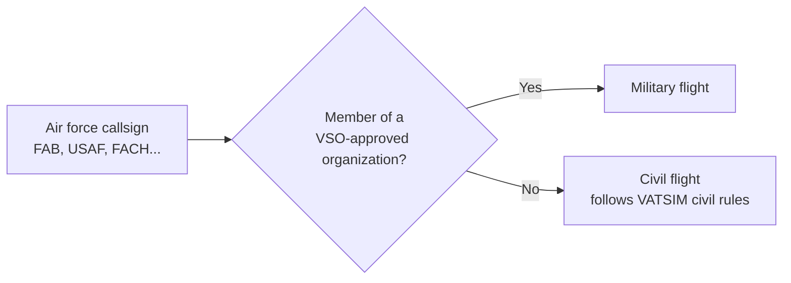

--8<-- "includes/abreviacoes.md"

# LOA – Força Aérea Brasileira virtual

Letter of Agreement · 2020 version

**FABv** – Força Aérea Brasileira virtual (Brazilian Virtual Air Force) 
**VATBRZ** – Vatsim Brasil

[:material-file-pdf-box: Original document (PDF, Portuguese)](https://www.fabv.com.br/site/assets/upload/LOA_v2020.pdf){ .md-button }
[:material-lightning-bolt: Go to the practical guide](#practical-guide){ .md-button }

!!! info "About this page"
    The text below is an English translation of the letter published by FABv in Portuguese. In case of any discrepancy, the original document prevails. At the end of the page, the [practical guide](#practical-guide) summarizes what the letter means day to day.

## Purpose

This Letter of Agreement (LOA) aims to establish operating procedures between VATBRZ's Military and Civil controllers, as well as to define what military flights are, the training for controllers and how FABv members should proceed on the VATSIM network.

These procedures and definitions are permanent once approved and announced to the network.

As is common knowledge, FABv, as a member of VSOA, is authorized to carry out military activities on the VATSIM network, as per the link below.

VSO Partner - <https://vasops.vatsim.net/>

## Distribution

This Letter will be distributed to all VATBRZ controllers and pilots, and published through whatever means are deemed necessary, so that everyone has access to its content at any time.

## Chapter I – Obligations

**Art. 1** All FABv and VATBRZ members, controllers or not, must ensure compliance with and respect the terms established in this letter.
{: .vb-loa-art }

**§ 1** Any act that violates the terms of this instrument will result in sanctions against whoever commits it.
{: .vb-loa-par }

**§ 2** Sanctions will be applied by the signatory Organizations, where applicable.
{: .vb-loa-par }

**Art. 2** FABv will keep up to date on its official website, under the “Quadro de Pessoal” (Personnel Roster) menu, the list of its active members (pilots and students), and the list of controllers under the “Quadro de ATC Militar” (Military ATC Roster) menu, in order to identify those who are part of its organization and define those who hold authorization/permission to carry out the military or special flights and control described in this letter.
{: .vb-loa-art }

## Chapter II – Military Flights

**Art. 3** Military flights are those carried out by FABv members listed on its official website, or by members of Organizations approved by VSO - VATSIM Special Operations, using an air force callsign.
{: .vb-loa-art }

**Sole paragraph** Any VATSIM user may connect with an air force callsign (FAB, FACH, USAF, etc.); however, users who do not belong to VSO-approved organizations are prohibited from flying with a military purpose. Their flights are classified as CIVIL and must therefore strictly follow VATSIM's civil flight standards.
{: .vb-loa-par }

## Chapter III – Military Operations

**Art. 4** Under VSOA regulations, a military operation is the simulation of military and/or paramilitary activities (the nature of the flight) and the conduct of military exercises with other VSO organizations, including:
{: .vb-loa-art }

- War games
- Aerial refueling
- Transport operations
- Low-level military formation routes
- Escort missions
- Air combat maneuvers
- Interception of other aircraft
- Access to special use airspace
- Search and Rescue
- Firefighting
- Humanitarian Aid
- PAR - Precision Approach Radar

**§ 1** Interception exercises may only be carried out with the Air Defense Control active.
{: .vb-loa-par }

## Chapter IV – Military Pilots

**Art. 5** A military pilot is one who:
{: .vb-loa-art }

**I –** belongs to the pilot roster of a VSOA-approved military/paramilitary organization, even if still taking their Organization's training course.
{: .vb-loa-inc }

**Sole paragraph** Training is a VSOA requirement and follows the standard it establishes.
{: .vb-loa-par }

## Chapter V – Military Control

**Art. 6** A military controller is one who meets the requirements set out in this article, namely:
{: .vb-loa-art }

**I –** has passed the military controller training given by FABv, obtaining, at the end of the training, a satisfactory grade and ranking according to the criteria listed in the annex to this letter;
{: .vb-loa-inc }

**Art. 7** Military controller students are prohibited from connecting to a military control position without the presence of a FABv instructor, who will monitor their activities during training.
{: .vb-loa-art }

**Art. 8** Whenever changes occur, FABv will update the list of its active controllers on its official website.
{: .vb-loa-art }

**Art. 9** Military control is the exclusive competence of military controllers and may only be performed at aerodromes considered military bases, listed in [Annex II](#annex-ii) to this document.
{: .vb-loa-art }

**Sole paragraph** Any kind of military control activity outside military bases is expressly prohibited, except for the Air Defense Center position.
{: .vb-loa-par }

**Art. 10** Only military controllers (C1 and C3) on FABv's active roster may staff the Air Defense Center position.
{: .vb-loa-art }

**§ 1** The military control position described in the head of this article is equivalent, in the military domain, to an ACC.
{: .vb-loa-par }

**§ 2** Activation of the Air Defense Center is occasional and restricted to official FABv events, training sessions and operations previously scheduled by its Command.
{: .vb-loa-par }

**§ 3** When activated for FABv operational training, the Air Defense Center will do so without prior notice to the FIR(s) involved or to the VATBRZ Board; for events and/or joint operations, a NOTAM will be sent electronically (website, email and social media) at least 24 hours in advance, with the activation date and time, for their awareness.
{: .vb-loa-par }

**Art. 11** At ATC positions already staffed by a civil controller at aerodromes considered military bases, when a military controller joins, the airspace will be divided and shared between civil and military, with the military controller handling the respective control in order to facilitate military flights.
{: .vb-loa-art }

**§ 1** When the airspace is divided as described in the head of this article, a communication channel must be opened to facilitate coordination between military and civil controllers.
{: .vb-loa-par }

**§ 2** The list of military bases is attached at the end of this document, in [Annex II](#annex-ii).
{: .vb-loa-par }

**Art. 12** At aerodromes considered military bases, when only a military controller is staffing ATC, they must take over coordination of the civil traffic present to avoid conflicts with military traffic.
{: .vb-loa-art }

**Art. 13** Where there is only a civil controller, the military pilot must keep in contact with the active civil control, or coordinate on the unicom frequency.
{: .vb-loa-art }

**Art. 14** Military controllers must faithfully observe the rating restrictions defined in special regulations, in order to properly staff the control positions they are qualified to staff.
{: .vb-loa-art }

**Sole paragraph** At its end, this Letter presents the Rating Definition Table and the respective Military Positions permitted for each rating, in [Annex I](#annex-i).
{: .vb-loa-par }

## Chapter VI – Military Controller Callsign

**Art. 15** Approved military controllers will be identified by the designator “MIL” in their callsign.
{: .vb-loa-art }

**Sole paragraph** Taking as an example the military approach control of the Air Force Academy in Pirassununga/SP, the military controller staffing that position will use the following callsign: `SBXQ_MIL_APP`.
{: .vb-loa-par }

**Art. 16** Only approved, duly trained military controllers listed on the FABv website may use the military callsign.
{: .vb-loa-art }

## Chapter VII – Temporary Restriction and/or Closure of Virtual Airspace

**Art. 17** FABv, as a VSOA member, reserves the right to temporarily restrict and/or close the airspace of a given region and/or aerodrome, provided it complies with this article:
{: .vb-loa-art }

**I –** notifies the FIR(s) involved and the Brazil Division (VATBRZ) of the closure at least 1 (one) week in advance.
{: .vb-loa-inc }

**II –** includes in the notice to the FIR(s) involved and VATBRZ the date(s), start and end time(s) of the closure, and the restricted and/or closed locations, so that they have enough time to inform the whole network.
{: .vb-loa-inc }

**III –** posts on VATSIM Brasil's communication channels, in its area and in the FIRs' areas, a NOTAM announcing the operation, date(s), start and end times, and a description and location of the operation.
{: .vb-loa-inc }

**Art. 18** During the temporary restriction and/or closure of the airspace, civil traffic in the marked areas will be monitored by Military and/or Civil ATC and routed outside the restricted airspace, including takeoffs and landings, should any conflict with the operation's procedures arise.
{: .vb-loa-art }

## Chapter VII – Military Controller Training

**Art. 19** Candidates for the military controller course must meet the following requirements:
{: .vb-loa-art }

**I –** hold at least an S2 rating, previously granted by VATBRZ.
{: .vb-loa-inc }

**II –** have at least 50 hours of effective control at an APP (approach) position before applying for enlistment through the “Alistamento” menu on the FABv website.
{: .vb-loa-inc }

## Chapter VIII – Final Provisions

**Art. 20** Cases not covered by this Letter shall be resolved jointly by the signatory Organizations.
{: .vb-loa-art }

## Annex I

List of ratings and the respective Military and Civil ATC positions they may staff after receiving approval and proper training.

| Rating | Military ATC position |
| ------ | --------------------- |
| S2 (Tower Controller) | Delivery (DEL), Ground (GND) and Tower (TWR). |
| S3 (TMA Terminal Controller) | Approach (APP) and Departure (DEP) positions. |
| C1 (Enroute Controller) C3 (Senior Controller) | 'Enroute' or 'Area' sectors (CTR); both radar and non-radar control services. |

**Note:** All users (members or guests) who connect as Military ATC must be duly listed on the FABv website.

## Annex II

List of Brazilian Virtual Air Force Units

| ICAO | MIL | Name |
| ---- | --- | ---- |
| SBBR | ALA 1 | Brasília Air Base |
| SBAN | ALA 2 | Anápolis Air Base |
| SBCO | ALA 3 | Canoas Air Base |
| SBSM | ALA 4 | Santa Maria Air Base |
| SBCG | ALA 5 | Campo Grande Air Base |
| SBPV | ALA 6 | Porto Velho Air Base |
| SBBV | ALA 7 | Boa Vista Air Base |
| SBMN | ALA 8 | Manaus Air Base |
| SBBE | ALA 9 | Belém Air Base |
| SBNT | ALA 10 | Parnamirim Air Base |
| SBGL | ALA 11 | Galeão Air Base |
| SBSC | ALA 12 | Santa Cruz Air Base |
| SBYS | AFAv | Air Force Academy |

## Signatures

| Força Aérea Brasileira virtual | Vatsim Brasil |
| :----------------------------: | :-----------: |
| Comando da Aeronáutica virtual | Division Board |

---

## Practical guide

!!! abstract "What this section is"
    A plain-language summary of what the letter means day to day for controllers and pilots. When in doubt, the official text above prevails.

### At a glance

-   :material-shield-airplane:{ .lg .middle } **Military flights are for members only**

    ---

    Anyone can use a callsign such as `FAB1234`, but only members of FABv or another VSO-approved organization fly with a military purpose.

-   :material-map-marker-radius:{ .lg .middle } **Military control only at the bases**

    ---

    Military positions open only at [military bases](#annex-ii). The only exception is the Air Defense Center.

-   :material-account-tie:{ .lg .middle } **Callsign with "MIL"**

    ---

    Military controllers are identified by `_MIL_` in their callsign, as in `SBYS_MIL_APP`.

-   :material-calendar-alert:{ .lg .middle } **Closures announced 1 week ahead**

    ---

    To restrict or close airspace, FABv notifies the FIRs and VATBRZ at least one week in advance.

### Is my flight military?

A flight is military only when the pilot is a **military pilot**: a member of FABv (or of another VSO-approved organization), listed on the organization's **Personnel Roster** website page, including students still in training.

!!! warning "A military callsign doesn't make the flight military"
    Anyone outside an approved organization may connect with an air force callsign, but the flight is **civil** and must strictly follow VATSIM's civil flight standards.

### Who controls what

Military control belongs exclusively to military controllers and only happens at [military bases](#annex-ii). What changes is who is online:

| Who is online at the base | How control works |
| ------------------------- | ----------------- |
| :material-account: Civil controller only | The military pilot contacts the civil controller. With no one online, coordinate on the unicom frequency. |
| :material-account-tie: Military controller only | The military controller also handles civil traffic, to avoid conflicts with military traffic. |
| :material-account-multiple: Civil and military | The airspace is split between civil and military. Each controls their own traffic, and both open a communication channel to coordinate. |

!!! tip "Civil controller at a military base"
    If a military controller joins your position, agree on the airspace split and the coordination channel right away. The split exists to make military flights easier, not to take your traffic away.

### How to become a military controller

The military controller course is run by FABv. To enlist, through the **Alistamento** (enlistment) menu on the FABv website, you need:

- [x] An **S2** rating or higher, obtained at VATBRZ
- [x] At least **50 hours** of effective control at an APP position

During the course, students only connect to a military position while a FABv instructor monitors them. Once approved, the controller is added to the **Quadro de ATC Militar** (military ATC roster) on the FABv website, and only those on that list may use a military callsign.

The positions each rating may staff are in [Annex I](#annex-i): S2 up to tower, S3 up to approach, C1 and C3 en route. The callsign has the designator **MIL** between the aerodrome and the position, as in `SBYS_MIL_APP`, the Air Force Academy's military approach.

### Air Defense Center

The Air Defense Center is the military position equivalent to an ACC. It is the only military position that can operate outside the bases.

- **Who can staff it:** only active FABv military controllers rated C1 or C3.
- **When it opens:** only for official FABv events, training sessions and operations scheduled by its Command.
- **Interceptions:** only take place with the Air Defense Center active.

=== "FABv training"

    The center may be activated **without prior notice** to the FIRs involved or to the VATBRZ Board.

=== "Event or joint operation"

    FABv publishes a **NOTAM** at least **24 hours** in advance, with the activation date and time, on its website, by email and on social media.

### Airspace closure

As a VSO member, FABv may temporarily restrict or close the airspace of a region or an aerodrome. To do so, it must:

1. **Notify the FIRs involved and VATBRZ at least 1 week in advance.**
2. **Include in the notice** the dates, start and end times, and the restricted locations.
3. **Publish a NOTAM** on Vatsim Brasil's and the FIRs' channels, with the operation, dates, times and location.

During the restriction, military or civil control monitors civil traffic in the area and routes it outside. This includes takeoffs and landings, if they conflict with the operation.

### General rules

- All FABv and VATBRZ members, controllers or not, must comply with this letter. Anyone who breaches it may be sanctioned by their own organization.
- FABv keeps its pilot and student list (**Quadro de Pessoal**) and its controller list (**Quadro de ATC Militar**) up to date on its website.
- Cases not covered by the letter are resolved jointly by FABv and VATBRZ.
