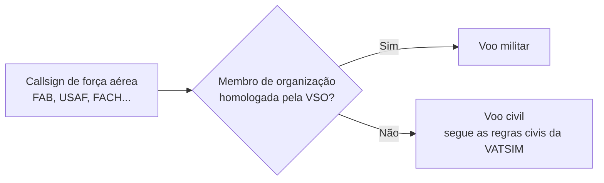

--8<-- "includes/abreviacoes.md"

# LOA – Força Aérea Brasileira virtual

Carta de Acordo Operacional · versão 2020

**FABv** – Força Aérea Brasileira virtual 
**VATBRZ** – Vatsim Brasil

[:material-file-pdf-box: Documento original (PDF)](https://www.fabv.com.br/site/assets/upload/LOA_v2020.pdf){ .md-button }
[:material-lightning-bolt: Ir para o guia prático](#guia-pratico){ .md-button }

!!! info "Sobre esta página"
    O texto abaixo é uma transcrição da carta publicada pela FABv, mantido como no original, com a correção de erros de digitação evidentes. Em caso de divergência, vale o documento original. No fim da página, o [guia prático](#guia-pratico) resume o que a carta muda no dia a dia.

## Objetivo

Esta carta de Acordo (LOA) visa estabelecer procedimentos de operação entre os controladores Militares e Civis da VATBRZ, bem como definir o que são vôos militares, os treinamentos para controladores e como os membros da FABv, na rede VATSIM, devem proceder.

Estes procedimentos e definições são de caráter permanente depois de aprovados e divulgados para a rede.

Como é de conhecimento de todos, que a FABv, por ser um membro da VSOA, está autorizada a realizar atividades militares dentro da rede VATSIM, conforme link abaixo.

VSO Partner - <https://vasops.vatsim.net/>

## Distribuição

Esta Carta será distribuída a todos os controladores e pilotos da VATBRZ, bem como publicada, através dos meios que se acharem necessários, para que todos tenham acesso ao seu conteúdo a qualquer tempo.

## Capítulo I – Das Obrigações

**Art. 1º** Todos os membros da FABv e VATBRZ, controladores ou não, devem zelar pelo cumprimento e respeitarem os termos estabelecidos nesta carta.
{: .vb-loa-art }

**§ 1º** Todo o ato que afronta os termos firmados neste instrumento implicará em sanção a quem o praticar.
{: .vb-loa-par }

**§ 2º** As sanções serão aplicadas pelas Organizações signatárias, se for o caso.
{: .vb-loa-par }

**Art. 2º** A FABv manterá atualizada em seu site oficial, no menu “Quadro de Pessoal” a listagem dos seus membros ativos (pilotos e alunos) e de controladores no menu “Quadro de ATC Militar”, a fim de identificar aqueles que fazem parte de sua organização e definir os que possuem autorização/permissão, para realizar vôos e controles de natureza militar ou especial descritos nesta carta.
{: .vb-loa-art }

## Capítulo II – Dos Vôos Militares

**Art. 3º** Os vôos militares são aqueles que realizados por membros da FABv, e que estejam listados no site oficial ou que pertençam a Organizações homologadas à VSO - VATSIM Special Operations, utilizando-se do callsign de força aérea.
{: .vb-loa-art }

**Parágrafo único** Qualquer usuário da rede VATSIM poderá conectar-se com um callsign de força aérea (FAB, FACH, USAF, etc..) entretanto, é proibido aos usuários não pertencentes a organizações homologadas pela VSO, realizarem vôos com objetivo militar, sendo seus vôos classificados como CIVIL, devendo portanto seguir estritamente o padrão de vôo civil da VATSIM.
{: .vb-loa-par }

## Capítulo III – Das Operações Militares

**Art. 4º** É considerada operação militar, de acordo com os regulamentos da VSOA, simular atividades militares e/ou para-militares (a natureza do vôo), a realização de exercícios militares com outras organizações VSO, estando dentre elas:
{: .vb-loa-art }

- Jogos de guerra
- Reabastecimento aéreo
- Operações de transporte
- Percursos de formação militar de baixo nível
- Missões de escolta
- Execução de manobras de combate aéreo
- Interceptação de outras aeronaves
- Ter acesso ao espaço aéreo de uso especial
- Busca e Resgate
- Combate a Incêndios
- Ajuda Humanitária
- PAR - Aproximação Radar de Precisão

**§ 1º** Exercícios de Interceptação somente poderão ser executados com a presença do Controle de Defesa Aérea ativo.
{: .vb-loa-par }

## Capítulo IV – Dos Pilotos Militares

**Art. 5º** É considerado piloto militar aquele que:
{: .vb-loa-art }

**I –** pertencer ao quadro de pilotos de uma organização militar/paramilitar homologada pela VSOA, mesmo que ainda esteja realizando o curso de formação da sua Organização.
{: .vb-loa-inc }

**Parágrafo único** Os treinamentos são uma exigência da VSOA e seguem o padrão estabelecido por ela.
{: .vb-loa-par }

## Capítulo V – Do Controle Militar

**Art. 6º** É considerado controlador militar aquele que preencher os requisitos mencionados neste artigo, a saber:
{: .vb-loa-art }

**I –** foi aprovado em seu treinamento para controlador militar, aplicado pela FABv, obtendo, ao final do treinamento, nota satisfatória e ranking de acordo com os critérios relacionados em anexo a esta carta;
{: .vb-loa-inc }

**Art. 7º** É vedado, ao estudante de controlador militar, conectar-se em posição de controle militar sem a presença de um instrutor da FABv. O qual irá monitorar sua atividades durante o treinamento.
{: .vb-loa-art }

**Art. 8º** A FABv, sempre que ocorrerem mudanças, fará alteração na listagem contendo os nomes de seus controladores da ativa, em seu site oficial.
{: .vb-loa-art }

**Art. 9º** O controle militar é de competência exclusiva dos controladores militares e somente pode ser efetuado em aeródromos considerados como bases militares, cuja listagem encontra-se no [Anexo II](#anexo-ii) a este documento.
{: .vb-loa-art }

**Parágrafo único** Fica expressamente proibido qualquer tipo de atividade de controle militar, fora de bases militares, exceto para posição de Centro de Defesa Aérea.
{: .vb-loa-par }

**Art. 10** Somente controlador militar (C1 e C3) pertencente ao quadro da ativa da FABv pode assumir a posição de Centro de Defesa Aérea.
{: .vb-loa-art }

**§ 1º** A posição de controle militar descrita no caput deste artigo é equivalente, no âmbito militar, ao ACC.
{: .vb-loa-par }

**§ 2º** A ativação do Centro de Defesa Aérea é eventual e restrita a eventos, treinamentos e operações oficiais da FABv previamente agendados pelo seu Comando.
{: .vb-loa-par }

**§ 3º** O Centro de Defesa Aérea, quando for ativado para treinamentos operacionais da FABv, fará sem prévio aviso a(s) FIR envolvida(s) ou a Diretoria da VATBRZ; quando ocorrer eventos e/ou operações conjuntas, será encaminhado Notam por meios eletrônicos, site, e-mail e mídias sociais, com o mínimo de 24 horas de antecedência, contendo data e hora da ativação para ciência das mesmas.
{: .vb-loa-par }

**Art. 11** Nas posições de ATC já ocupadas por controlador civil, em aeródromos considerados bases militares, quando ingressar um controlador militar, ocorrerá a divisão e a cooperação do espaço aéreo em civil e militar, onde o controlador militar fará o controle respectivo, para facilitar os vôos militares.
{: .vb-loa-art }

**§ 1º** Quando ocorrer a divisão do espaço aéreo, descrita no caput deste artigo, deverá ser aberto um canal de comunicação para facilitar a coordenação entre os controladores militares e civis.
{: .vb-loa-par }

**§ 2º** Ao final deste documento em anexo segue listagem das bases militares, no [Anexo II](#anexo-ii).
{: .vb-loa-par }

**Art. 12** Nos aeródromos considerados bases militares, quando houver apenas controlador militar na posição de ATC, o mesmo deverá assumir a coordenação do tráfego civil presente para evitar conflito com o tráfego militar.
{: .vb-loa-art }

**Art. 13** Onde houver apenas controlador civil, o piloto militar deverá manter contato com o controle civil ativo, ou com a coordenação na freqüência livre.
{: .vb-loa-art }

**Art. 14** Os controladores militares deverão observar, fielmente, as restrições de rating definidas em regulamento especial, para assumirem adequadamente as posições de controle e posição que o controlador militar está habilitado a assumir.
{: .vb-loa-art }

**Parágrafo único** Esta Carta, ao seu final, apresenta a Tabela de Definição de Rating e respectivas Posições Militares que são Permitidas para o mesmo, no [Anexo I](#anexo-i).
{: .vb-loa-par }

## Capítulo VI – Do Callsign do Controlador Militar

**Art. 15** Os controladores militares homologados serão identificados pelo designativo “MIL” em seu callsign.
{: .vb-loa-art }

**Parágrafo único** Tomado como exemplo o controle de aproximação militar da Academia da Força Aérea em Pirassununga/SP, o controlador militar, assumindo essa posição, terá o seguinte callsign: `SBXQ_MIL_APP`.
{: .vb-loa-par }

**Art. 16** Somente controlador militar homologado devidamente treinado e relacionado no site da FABv, poderá utilizar o callsign militar.
{: .vb-loa-art }

## Capítulo VII – Da Restrição e/ou Fechamento Temporário do Espaço Aéreo Virtual

**Art. 17** A FABv, por ser membro da VSOA, reserva-se ao direito de restringir e/ou fechar, temporariamente, o espaço aéreo de determinada região e/ou aeródromo, desde que cumpra o estabelecido neste artigo:
{: .vb-loa-art }

**I –** comunique, com o mínimo de 1 (uma) semana de antecedência, a(s) FIR envolvida(s) e Divisão do Brasil (VATBRZ), sobre o fechamento.
{: .vb-loa-inc }

**II –** envie, no comunicado à(s) FIR envolvida(s) e VATBRZ, a(s) data(s), horário(s) de início e término do fechamento bem como os locais de restrição e/ou fechamento, para que a mesma tenha tempo hábil de informar a toda rede.
{: .vb-loa-inc }

**III –** poste nos meios de comunicação da VATSIM Brasil em sua área e na área das FIRs, Notam anunciando a operação, data(s) e hora de início e término, bem como descritivo e local da operação.
{: .vb-loa-inc }

**Art. 18** Durante a restrição e/ou fechamento temporário do espaço aéreo, o tráfego civil nas áreas demarcadas, será monitorado pelo ATC Militar e/ou Civil, devendo ser desviado para fora do espaço aéreo restrito, incluindo-se os pousos e decolagens caso ocorra algum conflito para os procedimentos da operação.
{: .vb-loa-art }

## Capítulo VII – Da Instrução para Controladores Militares

**Art. 19** O candidato ao curso de controlador militar deverá preencher os seguintes requisitos:
{: .vb-loa-art }

**I –** possuir o rating mínimo de S2, tendo sido aprovado anteriormente pela VATBRZ para esse rating.
{: .vb-loa-inc }

**II –** possuir um mínimo de 50 horas de controle efetivo na posição de APP (aproximação), antes de solicitar o seu alistamento via site da FABv no menu “Alistamento”.
{: .vb-loa-inc }

## Capítulo VIII – Das Disposições Finais

**Art. 20** Os casos omissos relativos à matéria tratada nesta Carta deverão ser resolvidos em conjunto pelas Organizações signatárias.
{: .vb-loa-art }

## Anexo I

Listagem dos ratings e respectivas posições de ATC Militares e Civis, que podem assumir após recebimento da homologação e devido treinamento.

| Rating | Posição ATC militar |
| ------ | ------------------- |
| S2 (Tower Controller) | Delivery (DEL), Ground (GND) and Tower (TWR). |
| S3 (TMA Terminal Controller) | Approach (APP) and Departure (DEP) positions. |
| C1 (Enroute Controller) C3 (Senior Controller) | 'Enroute' or 'Area' sectors (CTR); both radar and non-radar control services. |

**Obs.:** Todos os usuários (membros ou convidados) que conectarem como ATC Militar, deverão estar devidamente relacionados no site da FABv.

## Anexo II

Relação das Unidades da Força Aérea Brasileira virtual

| ICAO | MIL | Nome |
| ---- | --- | ---- |
| SBBR | ALA 1 | Base Aérea de Brasília |
| SBAN | ALA 2 | Base Aérea de Anápolis |
| SBCO | ALA 3 | Base Aérea de Canoas |
| SBSM | ALA 4 | Base Aérea de Santa Maria |
| SBCG | ALA 5 | Base Aérea de Campo Grande |
| SBPV | ALA 6 | Base Aérea de Porto Velho |
| SBBV | ALA 7 | Base Aérea de Boa Vista |
| SBMN | ALA 8 | Base Aérea de Manaus |
| SBBE | ALA 9 | Base Aérea de Belém |
| SBNT | ALA 10 | Base Aérea de Parnamirim |
| SBGL | ALA 11 | Base Aérea do Galeão |
| SBSC | ALA 12 | Base Aérea de Santa Cruz |
| SBYS | AFAv | Academia da Força Aérea |

## Assinaturas

| Força Aérea Brasileira virtual | Vatsim Brasil |
| :----------------------------: | :-----------: |
| Comando da Aeronáutica virtual | Diretoria de Divisão |

---

## Guia prático

!!! abstract "O que é esta seção"
    Um resumo, sem linguagem jurídica, do que a carta muda no dia a dia de controladores e pilotos. Em caso de dúvida, vale o texto oficial acima.

### Em resumo

-   :material-shield-airplane:{ .lg .middle } **Voo militar é só de membro**

    ---

    Qualquer um pode usar um callsign como `FAB1234`, mas só membros da FABv ou de outra organização homologada pela VSO fazem voos com objetivo militar.

-   :material-map-marker-radius:{ .lg .middle } **Controle militar só nas bases**

    ---

    Posições militares abrem apenas nas [bases militares](#anexo-ii). A única exceção é o Centro de Defesa Aérea.

-   :material-account-tie:{ .lg .middle } **Callsign com "MIL"**

    ---

    O controlador militar se identifica pelo `_MIL_` no callsign, como em `SBYS_MIL_APP`.

-   :material-calendar-alert:{ .lg .middle } **Fechamento avisado com 1 semana**

    ---

    Para restringir ou fechar um espaço aéreo, a FABv avisa as FIRs e a VATBRZ com pelo menos uma semana de antecedência.

### Meu voo é militar?

Um voo só é militar quando quem voa é **piloto militar**: membro da FABv (ou de outra organização homologada pela VSO), listado no **Quadro de Pessoal** do site da organização, inclusive alunos em formação.

!!! warning "Callsign militar não torna o voo militar"
    Quem não pertence a uma organização homologada pode se conectar com um callsign de força aérea, mas o voo é **civil** e segue estritamente o padrão de voo civil da VATSIM.

### Quem controla o quê

O controle militar é exclusivo dos controladores militares e só acontece nas [bases militares](#anexo-ii). O que muda é quem está conectado:

| Quem está conectado na base | Como fica o controle |
| --------------------------- | -------------------- |
| :material-account: Só controlador civil | O piloto militar fala com o controle civil. Sem ninguém conectado, coordena na frequência livre. |
| :material-account-tie: Só controlador militar | O controlador militar assume também o tráfego civil, para evitar conflito com o tráfego militar. |
| :material-account-multiple: Civil e militar | O espaço aéreo é dividido entre civil e militar. Cada um controla o seu tráfego, e os dois abrem um canal de comunicação para coordenar. |

!!! tip "Controlador civil numa base militar"
    Se um controlador militar entrar na sua posição, combine logo a divisão do espaço aéreo e o canal de coordenação. A divisão existe para facilitar os voos militares, não para tirar o seu tráfego.

### Como se tornar controlador militar

O curso de controlador militar é dado pela FABv. Para se alistar, pelo menu **Alistamento** do site da FABv, você precisa de:

- [x] Rating **S2** ou superior, obtido na VATBRZ
- [x] Pelo menos **50 horas** de controle efetivo em posição de APP

Durante o curso, o aluno só se conecta em posição militar com um instrutor da FABv monitorando. Depois de aprovado, o controlador passa a constar no **Quadro de ATC Militar** do site da FABv, e só quem está nessa lista pode usar um callsign militar.

As posições que cada rating pode assumir estão no [Anexo I](#anexo-i): S2 até a torre, S3 até a aproximação, C1 e C3 em rota. O callsign leva o designativo **MIL** entre o aeródromo e a posição, como em `SBYS_MIL_APP`, a aproximação militar da Academia da Força Aérea.

### Centro de Defesa Aérea

O Centro de Defesa Aérea é a posição militar equivalente ao ACC. É a única posição militar que pode funcionar fora das bases.

- **Quem pode assumir:** só controladores militares C1 ou C3 da ativa na FABv.
- **Quando abre:** só em eventos, treinamentos e operações oficiais da FABv agendados pelo Comando.
- **Interceptações:** só acontecem com o Centro de Defesa Aérea ativo.

=== "Treinamento da FABv"

    O centro pode ser ativado **sem aviso prévio** às FIRs envolvidas ou à Diretoria da VATBRZ.

=== "Evento ou operação conjunta"

    A FABv publica um **NOTAM** com pelo menos **24 horas** de antecedência, com data e hora da ativação, pelo site, por e-mail e pelas redes sociais.

### Fechamento de espaço aéreo

Como membro da VSO, a FABv pode restringir ou fechar temporariamente o espaço aéreo de uma região ou de um aeródromo. Para isso, ela precisa:

1. **Avisar com 1 semana de antecedência** as FIRs envolvidas e a VATBRZ.
2. **Informar no aviso** as datas, os horários de início e de término e os locais da restrição.
3. **Publicar um NOTAM** nos canais da Vatsim Brasil e das FIRs, com a operação, as datas, os horários e o local.

Durante a restrição, o controle militar ou civil monitora o tráfego civil na área e o desvia para fora dela. Isso inclui pousos e decolagens, se conflitarem com a operação.

### Regras gerais

- Todos os membros da FABv e da VATBRZ, controladores ou não, devem cumprir esta carta. Quem descumprir pode ser punido pela organização a que pertence.
- A FABv mantém atualizadas no seu site as listas de pilotos e alunos (**Quadro de Pessoal**) e de controladores (**Quadro de ATC Militar**).
- Casos que a carta não prevê são resolvidos em conjunto pela FABv e pela VATBRZ.
