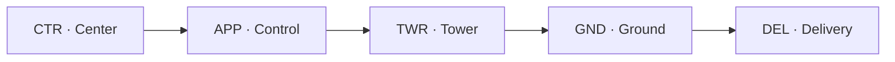

--8<-- "includes/abreviacoes.md"

# Positions and Units

A flight with full ATC passes through several positions, each responsible for one stage. Tap each point on the profile to see what that position does, or use the keyboard arrows to step through the flight.

<section data-sigla="DEL" data-nome="Delivery" data-alt="0" markdown>

### Delivery · `_DEL` · *Tráfego*

**Where:** on the ground, before the aircraft moves.

**What it does:** checks the flight plan and issues the **ATC clearance**: destination, route, level, departure (SID) and squawk code.

**Example callsign:** `SBGR_DEL`, called *Tráfego Guarulhos* or *Guarulhos Delivery*.

**Minimum rating:** S1.

</section>

<section data-sigla="GND" data-nome="Ground" data-alt="0" markdown>

### Ground · `_GND` · *Solo*

**Where:** aprons and taxiways.

**What it does:** approves startup and *pushback* and guides the aircraft along the taxi route to the runway holding point, avoiding conflicts on the ground.

**Example callsign:** `SBGR_GND`, *Solo Guarulhos* or *Guarulhos Ground*.

**Minimum rating:** S1.

</section>

<section data-sigla="TWR" data-nome="Tower" data-alt="1" markdown>

### Tower · `_TWR` · *Torre*

**Where:** on the runway and around the aerodrome.

**What it does:** clears takeoffs and landings, runway crossings and VFR traffic in the circuit. It owns the runway: nothing enters it without Tower's clearance.

**Example callsign:** `SBGR_TWR`, *Torre Guarulhos* or *Guarulhos Tower*.

**Minimum rating:** S2.

!!! note "What about RADIO?"
    At aerodromes without a control tower, the `_R_TWR` position provides the aerodrome flight information service (AFIS): it informs, but does not clear. See the [AFIS (Radio) Manual](../../documentos/manuais/afis-radio/index.en.md).

</section>

<section data-sigla="APP" data-nome="Control (departure)" data-alt="2" markdown>

### Control · `_APP` · *Approach/Departure*

**Where:** in the terminal control area (TMA), around one or more aerodromes.

**What it does on departure:** takes the aircraft right after takeoff, separates departures from each other and from arrivals, and hands it to Center already climbing.

**Example callsign:** `SBXP_APP`, *Controle São Paulo* or *São Paulo Control*.

**Minimum rating:** S3.

</section>

<section data-sigla="CTR" data-nome="Center" data-alt="3" markdown>

### Center · `_CTR` · *Centro*

**Where:** on the airways, outside the TMAs, covering an entire flight information region (FIR) or a sector of it.

**What it does:** separates en route aircraft, approves level and route changes, and starts the descent to the destination.

**Example callsign:** `SBBS_CTR`, *Centro Brasília* or *Brasília Center*.

**Minimum rating:** C1.

</section>

<section data-sigla="APP" data-nome="Control (arrival)" data-alt="2" markdown>

### Control · `_APP` · on arrival

**What it does on arrival:** takes the aircraft in the descent, builds the landing sequence with vectors, speeds and holds, and clears the final approach. It hands the aircraft to Tower already stabilized.

This is the busiest job on the network on event days. The [Vectoring and Sequencing Manual](../../documentos/manuais/vetoracao-sequenciamento/index.en.md) covers the techniques in detail.

</section>

<section data-sigla="TWR" data-nome="Tower (landing)" data-alt="1" markdown>

### Tower · `_TWR` · on landing

**What it does on landing:** clears the landing, gives the wind and, once the aircraft vacates the runway, hands it to Ground. It keeps runway separation between landings and takeoffs.

</section>

<section data-sigla="GND" data-nome="Ground (arrival)" data-alt="0" markdown>

### Ground · `_GND` · on arrival

**What it does on arrival:** guides the aircraft from the runway exit to the gate or parking stand. End of the flight.

</section>

## What if the position is empty?

On the network, positions open and close as controllers connect. That is why **top-down coverage** applies: a position covers the empty positions below it.

If only `SBXP_APP` (São Paulo Control) is online, it also acts as Tower, Ground and Delivery at the aerodromes in the TMA it covers. The coverage order for each TMA is in the [Terminals](../../MOP/terminais/index.en.md) section, and the full rules are in the [Coordination and Handoff Manual](../../documentos/manuais/coordenacao-transferencia/04-rede.en.md).

!!! tip "The ATIS"
    Besides the control positions, larger aerodromes have an `_ATIS` position, a recording with the runway in use, wind, weather conditions and notices. The controller keeps the ATIS up to date with [vATIS](../softwares/vatis/index.en.md), and the pilot listens to it before the first call.

## Who talks to whom

| Position | Callsign in Portuguese | In English | Rating |
| --- | --- | --- | --- |
| `_DEL` | Tráfego | Delivery | S1 |
| `_GND` | Solo | Ground | S1 |
| `_TWR` | Torre | Tower | S2 |
| `_APP` | Controle | Control | S3 |
| `_CTR` | Centro | Center | C1 |

Next step: see how you move up from one position to the next in [Ratings and training](ratings.en.md).
