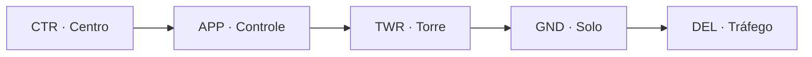

--8<-- "includes/abreviacoes.md"

# Posições e Órgãos

Um voo com ATC completo passa por várias posições, cada uma responsável por um trecho. Toque em cada ponto do perfil para ver o que aquela posição faz, ou use as setas do teclado para percorrer o voo.

<section data-sigla="DEL" data-nome="Tráfego" data-alt="0" markdown>

### Tráfego · `_DEL` · *Delivery*

**Onde:** no solo, antes de a aeronave se mover.

**O que faz:** confere o plano de voo e emite a **autorização de tráfego**: destino, rota, nível, saída (SID) e código transponder.

**Exemplo de indicativo:** `SBGR_DEL`, chamado de *Tráfego Guarulhos* ou *Guarulhos Delivery*.

**Rating mínimo:** S1.

</section>

<section data-sigla="GND" data-nome="Solo" data-alt="0" markdown>

### Solo · `_GND` · *Ground*

**Onde:** pátios e pistas de táxi.

**O que faz:** autoriza o acionamento e o *pushback* e conduz a aeronave pelo táxi até o ponto de espera da pista, evitando conflitos no solo.

**Exemplo de indicativo:** `SBGR_GND`, *Solo Guarulhos* ou *Guarulhos Ground*.

**Rating mínimo:** S1.

</section>

<section data-sigla="TWR" data-nome="Torre" data-alt="1" markdown>

### Torre · `_TWR` · *Tower*

**Onde:** na pista e no entorno do aeródromo.

**O que faz:** autoriza decolagens e pousos, cruzamentos de pista e o tráfego VFR no circuito. É a dona da pista: nada entra nela sem a autorização da Torre.

**Exemplo de indicativo:** `SBGR_TWR`, *Torre Guarulhos* ou *Guarulhos Tower*.

**Rating mínimo:** S2.

!!! note "E a RÁDIO?"
    Nos aeródromos sem torre de controle, a posição `_R_TWR` presta o serviço de informação de voo (AFIS): ela informa, mas não autoriza. Veja o [Manual de AFIS (Rádio)](../../documentos/manuais/afis-radio/index.pt.md).

</section>

<section data-sigla="APP" data-nome="Controle (saída)" data-alt="2" markdown>

### Controle · `_APP` · *Approach/Departure*

**Onde:** na área de controle terminal (TMA), em torno de um ou mais aeródromos.

**O que faz, na saída:** recebe a aeronave logo após a decolagem, separa as saídas umas das outras e das chegadas e a entrega ao Centro já em subida.

**Exemplo de indicativo:** `SBXP_APP`, *Controle São Paulo* ou *São Paulo Control*.

**Rating mínimo:** S3.

</section>

<section data-sigla="CTR" data-nome="Centro" data-alt="3" markdown>

### Centro · `_CTR` · *Center*

**Onde:** nas aerovias, fora das TMAs, cobrindo uma região de informação de voo (FIR) inteira ou um setor dela.

**O que faz:** separa as aeronaves em rota, autoriza mudanças de nível e de rota e inicia a descida para o destino.

**Exemplo de indicativo:** `SBBS_CTR`, *Centro Brasília* ou *Brasília Center*.

**Rating mínimo:** C1.

</section>

<section data-sigla="APP" data-nome="Controle (chegada)" data-alt="2" markdown>

### Controle · `_APP` · na chegada

**O que faz, na chegada:** recebe a aeronave em descida, organiza a sequência de pouso com vetores, velocidades e esperas, e autoriza a aproximação final. Entrega a aeronave à Torre já estabilizada.

Esse é o trabalho mais intenso da rede em dia de evento. O [Manual de Vetoração e Sequenciamento](../../documentos/manuais/vetoracao-sequenciamento/index.pt.md) detalha as técnicas.

</section>

<section data-sigla="TWR" data-nome="Torre (pouso)" data-alt="1" markdown>

### Torre · `_TWR` · no pouso

**O que faz, no pouso:** autoriza o pouso, informa vento e, depois que a aeronave livra a pista, transfere para o Solo. Mantém a separação na pista entre pousos e decolagens.

</section>

<section data-sigla="GND" data-nome="Solo (chegada)" data-alt="0" markdown>

### Solo · `_GND` · na chegada

**O que faz, na chegada:** conduz a aeronave da saída da pista até o portão ou a posição de estacionamento. Fim do voo.

</section>

## E se a posição estiver vazia?

Na rede, as posições abrem e fecham conforme os controladores se conectam. Por isso vale a **cobertura top-down**: uma posição cobre as posições abaixo dela que estão vazias.

Se só o `SBXP_APP` (Controle São Paulo) estiver on-line, ele também faz o papel de Torre, Solo e Tráfego nos aeródromos da TMA que cobre. A ordem de cobertura de cada TMA está na seção [Terminais](../../MOP/terminais/index.pt.md), e as regras completas no [Manual de Coordenação e Transferência](../../documentos/manuais/coordenacao-transferencia/04-rede.pt.md).

!!! tip "O ATIS"
    Além das posições de controle, os aeródromos maiores têm a posição `_ATIS`, uma gravação com pista em uso, vento, condições meteorológicas e avisos. O controlador mantém o ATIS atualizado com o [vATIS](../softwares/vatis/index.pt.md), e o piloto o escuta antes da primeira chamada.

## Quem fala com quem

| Posição | Indicativo em português | Em inglês | Rating |
| --- | --- | --- | --- |
| `_DEL` | Tráfego | Delivery | S1 |
| `_GND` | Solo | Ground | S1 |
| `_TWR` | Torre | Tower | S2 |
| `_APP` | Controle | Control | S3 |
| `_CTR` | Centro | Center | C1 |

Próximo passo: entenda como você sobe de uma posição para outra em [Ratings e treinamento](ratings.pt.md).
