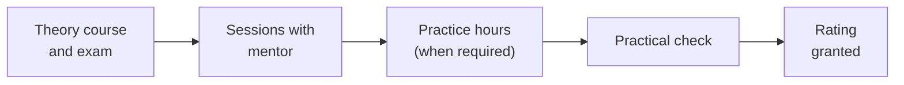

--8<-- "includes/abreviacoes.md"

# Ratings and Training

On VATSIM, controllers progress through **ratings**, qualifications that unlock increasingly complex positions, as in real-world ATC training. Each step requires study, training with a mentor and, from S2 onwards, a practical *check*.

Tap each step to see what it unlocks and what you need to reach it.

<section data-sigla="OBS" data-nome="Observer" data-alt="0" markdown>

### OBS · Observer

**You start here.** Every new VATSIM account is OBS.

**What it unlocks:** connecting as an observer, with a callsign ending in `_OBS`, to see traffic and listen to frequencies without transmitting.

**To move up:** be a resident member of Vatsim Brasil and follow the [controller path](index.en.md).

</section>

<section data-sigla="S1" data-nome="Developing Controller" data-alt="1" markdown>

### S1 · *Developing Controller*

**What it unlocks:** the **Delivery** (`_DEL`) and **Ground** (`_GND`) positions within the Vatsim Brasil jurisdiction.

**Requirements:**

- pass the theory exam at the [Vatsim Brasil Training Center](https://treinamento.vatsim.com.br);
- familiarization training with a mentor.

</section>

<section data-sigla="S2" data-nome="Aerodrome Controller" data-alt="2" markdown>

### S2 · *Aerodrome Controller*

**What it unlocks:** the **Tower** (`_TWR`) positions.

**Requirements:**

- pass the theory exam at the [Training Center](https://treinamento.vatsim.com.br);
- advanced training with a mentor;
- practical *check*.

</section>

<section data-sigla="S3" data-nome="Terminal Controller" data-alt="3" markdown>

### S3 · *Terminal Controller*

**What it unlocks:** the **Control** (`_APP`) positions.

**Requirements:**

- pass the theory exam at the [Training Center](https://treinamento.vatsim.com.br);
- at least **10 hours** connected on `_TWR` as S2;
- advanced training with a mentor;
- at least **10 hours** of *solo trainee* time on `_APP`;
- practical *check*.

</section>

<section data-sigla="C1" data-nome="Enroute Controller" data-alt="4" markdown>

### C1 · *Enroute Controller*

**What it unlocks:** the **Center** (`_CTR`) positions.

**Requirements:**

- pass the theory exam at the [Training Center](https://treinamento.vatsim.com.br);
- at least **10 hours** connected on `_APP` as S3;
- advanced training with a mentor;
- at least **15 hours** of *solo trainee* time on `_CTR`;
- practical *check*.

</section>

<section data-sigla="C3" data-nome="Senior Controller" data-alt="5" markdown>

### C3 · *Senior Controller*

Recognition for experienced controllers. The requirements are in section 3.6 of the [Vatsim Brasil Division Policy](https://vatsim.com.br/documentos/politica-de-divisao).

</section>

<section data-sigla="I1" data-nome="Instructor" data-alt="6" markdown>

### I1 · *Instructor*

The controller who trains other controllers. The requirements are in section 4.1 of the [Vatsim Brasil Division Policy](https://vatsim.com.br/documentos/politica-de-divisao).

</section>

<section data-sigla="I3" data-nome="Senior Instructor" data-alt="7" markdown>

### I3 · *Senior Instructor*

The requirements are in section 4.2 of the [Vatsim Brasil Division Policy](https://vatsim.com.br/documentos/politica-de-divisao).

</section>

## What is *solo trainee*?

Before the S3 and C1 *check*, the controller gets a temporary authorization to staff the new position alone, without the mentor alongside. *Solo trainee* hours are for building rhythm with real traffic before the assessment.

## How training works

1. **Course and theory exam** at the [Training Center](https://treinamento.vatsim.com.br).
2. **One-on-one practical sessions**, scheduled by *ticket* on the Vatsim Brasil Discord. You control in a training environment while the mentor watches, corrects and guides.
3. **Minimum hours**, when the rating requires them: connected time on your current rating and *solo trainee* time on the new position.
4. **Practical check**: an assessed session. If you pass, the mentor forwards the result to the training staff, who grant the rating.

!!! tip "Make the most of the hours"
    Minimum hours are not an obstacle, they are the training. Connect at busy times, ask a more experienced controller to observe you and use the [manuals](../../documentos/index.en.md) to clear up any questions that come up.

## Ratings and positions side by side

| Rating | `_DEL` | `_GND` | `_TWR` | `_APP` | `_CTR` |
| --- | :---: | :---: | :---: | :---: | :---: |
| S1 | :material-check: | :material-check: | | | |
| S2 | :material-check: | :material-check: | :material-check: | | |
| S3 | :material-check: | :material-check: | :material-check: | :material-check: | |
| C1 and above | :material-check: | :material-check: | :material-check: | :material-check: | :material-check: |

Ready to connect? See the [first session checklist](primeira-sessao.en.md).
