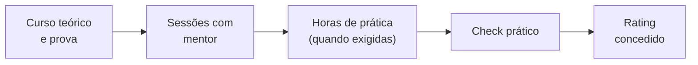

--8<-- "includes/abreviacoes.md"

# Ratings e Treinamento

Na VATSIM, o controlador avança por **ratings**, habilitações que liberam posições cada vez mais complexas, como no treinamento ATC do mundo real. Cada degrau exige estudo, treinamento com mentor e, a partir do S2, um *check* prático.

Toque em cada degrau para ver o que ele libera e o que é preciso para alcançá-lo.

<section data-sigla="OBS" data-nome="Observador" data-alt="0" markdown>

### OBS · Observador

**Você começa aqui.** Toda conta nova da VATSIM é OBS.

**O que libera:** conectar como observador, com indicativo terminado em `_OBS`, para ver o tráfego e ouvir as frequências sem transmitir.

**Para subir:** ser membro residente da Vatsim Brasil e seguir a [trilha do controlador](index.pt.md).

</section>

<section data-sigla="S1" data-nome="Controlador em desenvolvimento" data-alt="1" markdown>

### S1 · *Developing Controller*

**O que libera:** as posições de **Tráfego** (`_DEL`) e **Solo** (`_GND`) na jurisdição da Vatsim Brasil.

**Requisitos:**

- aprovação na prova teórica no [Centro de Treinamento da Vatsim Brasil](https://treinamento.vatsim.com.br);
- treinamento com um mentor para ambientação.

</section>

<section data-sigla="S2" data-nome="Controlador de aeródromo" data-alt="2" markdown>

### S2 · *Aerodrome Controller*

**O que libera:** as posições de **Torre** (`_TWR`).

**Requisitos:**

- aprovação na prova teórica no [Centro de Treinamento](https://treinamento.vatsim.com.br);
- treinamento com um mentor para aprofundamento;
- *check* prático.

</section>

<section data-sigla="S3" data-nome="Controlador de terminal" data-alt="3" markdown>

### S3 · *Terminal Controller*

**O que libera:** as posições de **Controle** (`_APP`).

**Requisitos:**

- aprovação na prova teórica no [Centro de Treinamento](https://treinamento.vatsim.com.br);
- **10 horas** mínimas de conexão em `_TWR` como S2;
- treinamento com um mentor para aprofundamento;
- **10 horas** mínimas de *solo trainee* como `_APP`;
- *check* prático.

</section>

<section data-sigla="C1" data-nome="Controlador em rota" data-alt="4" markdown>

### C1 · *Enroute Controller*

**O que libera:** as posições de **Centro** (`_CTR`).

**Requisitos:**

- aprovação na prova teórica no [Centro de Treinamento](https://treinamento.vatsim.com.br);
- **10 horas** mínimas de conexão em `_APP` como S3;
- treinamento com um mentor para aprofundamento;
- **15 horas** mínimas de *solo trainee* como `_CTR`;
- *check* prático.

</section>

<section data-sigla="C3" data-nome="Controlador sênior" data-alt="5" markdown>

### C3 · *Senior Controller*

O reconhecimento do controlador experiente. Os requisitos estão na seção 3.6 da [Política de Divisão da Vatsim Brasil](https://vatsim.com.br/documentos/politica-de-divisao).

</section>

<section data-sigla="I1" data-nome="Instrutor" data-alt="6" markdown>

### I1 · *Instructor*

O controlador que forma outros controladores. Os requisitos estão na seção 4.1 da [Política de Divisão da Vatsim Brasil](https://vatsim.com.br/documentos/politica-de-divisao).

</section>

<section data-sigla="I3" data-nome="Instrutor sênior" data-alt="7" markdown>

### I3 · *Senior Instructor*

Os requisitos estão na seção 4.2 da [Política de Divisão da Vatsim Brasil](https://vatsim.com.br/documentos/politica-de-divisao).

</section>

## O que é *solo trainee*?

Antes do *check* de S3 e de C1, o controlador ganha uma autorização temporária para ocupar sozinho a posição nova, sem o mentor ao lado. As horas de *solo trainee* servem para ganhar ritmo com tráfego real antes da avaliação.

## Como funciona o treinamento

1. **Curso e prova teórica** no [Centro de Treinamento](https://treinamento.vatsim.com.br).
2. **Sessões práticas** individuais, agendadas por *ticket* no Discord da Vatsim Brasil. Você controla num ambiente de treino e o mentor acompanha, corrige e orienta.
3. **Horas mínimas**, quando o rating exige: conexão no rating atual e *solo trainee* na posição nova.
4. **Check prático**: uma sessão avaliada. Aprovado, o mentor encaminha o resultado à equipe de treinamento, que concede o rating.

!!! tip "Aproveite as horas"
    As horas mínimas não são um obstáculo, são o treino. Conecte nos horários de movimento, peça a um controlador mais experiente para observar você e use os [manuais](../../documentos/index.pt.md) para tirar as dúvidas que surgirem.

## Ratings e posições, lado a lado

| Rating | `_DEL` | `_GND` | `_TWR` | `_APP` | `_CTR` |
| --- | :---: | :---: | :---: | :---: | :---: |
| S1 | :material-check: | :material-check: | | | |
| S2 | :material-check: | :material-check: | :material-check: | | |
| S3 | :material-check: | :material-check: | :material-check: | :material-check: | |
| C1 e acima | :material-check: | :material-check: | :material-check: | :material-check: | :material-check: |

Pronto para conectar? Veja o [checklist da primeira sessão](primeira-sessao.pt.md).
