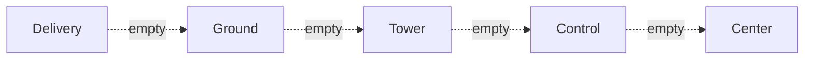

--8<-- "includes/abreviacoes.md"

# Who to Talk To

In each phase of flight, a different ATC unit is responsible for you. Tap the points on the profile to see when to call each one and what to ask for.

<div class="vb-perfil" data-forma="voo" markdown>

<section data-sigla="ATIS" data-nome="Information" data-alt="0" markdown>

### First of all: the ATIS

**When:** at the gate, before your first call.

**What it is:** a recording with the runway in use, wind, visibility, altimeter setting and notices. Each version has a letter: *Information BRAVO*.

**What to do:** listen, note the letter and report it on your first call. That way the controller knows you have the latest data.

</section>

<section data-sigla="DEL" data-nome="Delivery" data-alt="0" markdown>

### Delivery

**When:** at the gate, with your flight plan filed, before startup.

**What to ask for:** your ATC clearance (*"request ATC clearance, information BRAVO"*).

**What you get:** destination, route, level, departure (SID), squawk code and the Control frequency. **Read it all back.**

</section>

<section data-sigla="GND" data-nome="Ground" data-alt="0" markdown>

### Ground

**When:** once cleared, ready for *pushback* or startup.

**What to ask for:** *pushback* and startup; then taxi.

**What you get:** the taxi route to the runway holding point. Read back the runway and any hold instruction (*"hold position"*, *"hold short of runway"*).

</section>

<section data-sigla="TWR" data-nome="Tower" data-alt="1" markdown>

### Tower

**When:** approaching the holding point, when Ground tells you to call.

**What to ask for:** nothing; report that you are ready (*"ready for departure"*).

**What you get:** clearance to line up and take off, with the wind. After takeoff, Tower hands you over to Control.

!!! warning "Never enter the runway without clearance"
    Not even to line up. Only Tower can clear you.

</section>

<section data-sigla="APP" data-nome="Control (departure)" data-alt="2" markdown>

### Control (APP)

**When:** right after takeoff, when Tower hands you over.

**First call:** callsign, current level and cleared level (*"climbing to flight level EIGHT ZERO"*).

**What you get:** climb, headings and shortcuts. Then the handover to Center.

</section>

<section data-sigla="CTR" data-nome="Center" data-alt="3" markdown>

### Center

**When:** en route, after leaving the terminal area.

**What to expect:** climb to cruising level, possible shortcuts and, near the destination, descent clearance. Center may hand you over between sectors and between different centers.

**Tip:** prepare the arrival (STAR, approach, destination ATIS) while still in cruise.

</section>

<section data-sigla="APP" data-nome="Control (arrival)" data-alt="2" markdown>

### Control · on arrival

**When:** in descent, when Center hands you over.

**First call:** callsign, level and the destination ATIS letter.

**What you get:** the sequence for landing, with vectors, speeds and approach clearance. Follow it precisely: there are other aircraft in line.

</section>

<section data-sigla="TWR" data-nome="Tower (landing)" data-alt="1" markdown>

### Tower · landing

**When:** on final approach, when Control hands you over.

**What you get:** landing clearance and the wind. After landing, vacate the runway at the first suitable exit and wait for the instruction to contact Ground.

</section>

<section data-sigla="GND" data-nome="Ground (arrival)" data-alt="0" markdown>

### Ground · on arrival

**When:** once the runway is vacated.

**What to ask for:** taxi to the gate or parking stand.

Parked? You can disconnect. Have a good flight!

</section>

</div>

## Nobody on that position? Top-down

The network rarely has every position staffed. When one is empty, **the next online position above it serves you**. To find who to call, climb the ladder until you find someone:



Example: at Guarulhos, with no Delivery, Ground or Tower, but with São Paulo Control online, you call **São Paulo Control** for clearance, taxi and takeoff.

How to know who is online:

- the **network map** ([VATSIM Radar](https://vatsim-radar.com) or similar);
- the **controller list** in your pilot client, which shows callsign and frequency;
- each controller's **information message**, which usually states the area they cover.

## No ATC at all: UNICOM

If nobody covers your aerodrome, you fly uncontrolled, but not alone. Tune **UNICOM, 122.800**, and announce your intentions to other pilots at key moments:

- before taxiing and before entering the runway;
- on takeoff;
- when joining the circuit or starting the approach;
- when vacating the runway.

```text
Guarulhos traffic, GOL1419, taxiing to runway 28L, Guarulhos.
```

Start and end the message with the aerodrome name, so pilots elsewhere know it is not for them. When you enter an online controller's area, leave UNICOM and call them.

!!! tip "For the details"
    The [Coordination and Transfer Manual](../../documentos/manuais/coordenacao-transferencia/04-rede.en.md) explains top-down coverage from the controller's point of view, and the [Terminals](../../MOP/terminais/index.en.md) pages show the coverage order for each TMA.

Now practise the calls in the [radio simulator](radio.en.md).
