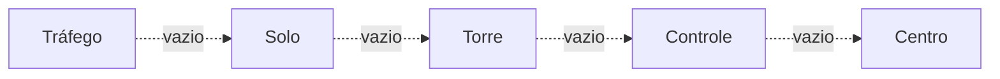

--8<-- "includes/abreviacoes.md"

# Com Quem Falar

Em cada fase do voo, um órgão diferente é responsável por você. Toque nos pontos do perfil para ver quando chamar cada um e o que pedir.

<div class="vb-perfil" data-forma="voo" markdown>

<section data-sigla="ATIS" data-nome="Informação" data-alt="0" markdown>

### Antes de tudo: o ATIS

**Quando:** no portão, antes da primeira chamada.

**O que é:** uma gravação com a pista em uso, vento, visibilidade, ajuste de altímetro e avisos. Cada versão tem uma letra: *Informação BRAVO*.

**O que fazer:** escute, anote a letra e informe-a na primeira chamada. Assim o controlador sabe que você tem os dados atualizados.

</section>

<section data-sigla="DEL" data-nome="Tráfego" data-alt="0" markdown>

### Tráfego · *Delivery*

**Quando:** no portão, com o plano de voo enviado, antes de acionar.

**O que pedir:** a autorização de tráfego (*"solicita autorização ATC, informação BRAVO"*).

**O que você recebe:** destino, rota, nível, saída (SID), código transponder e a frequência do Controle. **Coteje tudo.**

</section>

<section data-sigla="GND" data-nome="Solo" data-alt="0" markdown>

### Solo · *Ground*

**Quando:** autorizado, pronto para o *pushback* ou acionamento.

**O que pedir:** *pushback* e acionamento; depois, o táxi.

**O que você recebe:** a rota de táxi até o ponto de espera da pista. Coteje a pista e qualquer instrução de espera (*"mantenha posição"*, *"aguarde antes da pista"*).

</section>

<section data-sigla="TWR" data-nome="Torre" data-alt="1" markdown>

### Torre · *Tower*

**Quando:** chegando ao ponto de espera, quando o Solo mandar chamar.

**O que pedir:** nada; informe que está pronto (*"pronto para decolagem"*).

**O que você recebe:** a autorização para alinhar e decolar, com o vento. Depois da decolagem, a Torre transfere você para o Controle.

!!! warning "Nunca entre na pista sem autorização"
    Nem para alinhar. Só a Torre autoriza.

</section>

<section data-sigla="APP" data-nome="Controle (saída)" data-alt="2" markdown>

### Controle · *Control*

**Quando:** logo após a decolagem, quando a Torre transferir.

**Primeira chamada:** indicativo, nível atual e nível autorizado (*"subindo para o nível OITO ZERO"*).

**O que você recebe:** subida, proas e atalhos. Depois, a transferência para o Centro.

</section>

<section data-sigla="CTR" data-nome="Centro" data-alt="3" markdown>

### Centro · *Center*

**Quando:** em rota, ao sair da terminal.

**O que esperar:** subida até o nível de cruzeiro, eventuais atalhos e, perto do destino, a autorização de descida. O Centro pode transferir você entre setores e entre centros diferentes.

**Dica:** prepare a chegada (STAR, aproximação, ATIS do destino) ainda em cruzeiro.

</section>

<section data-sigla="APP" data-nome="Controle (chegada)" data-alt="2" markdown>

### Controle · na chegada

**Quando:** em descida, quando o Centro transferir.

**Primeira chamada:** indicativo, nível e a letra do ATIS do destino.

**O que você recebe:** a sequência para o pouso, com vetores, velocidades e a autorização de aproximação. Siga com precisão: há outros aviões na fila.

</section>

<section data-sigla="TWR" data-nome="Torre (pouso)" data-alt="1" markdown>

### Torre · no pouso

**Quando:** na aproximação final, quando o Controle transferir.

**O que você recebe:** a autorização de pouso e o vento. Depois do pouso, livre a pista pela primeira saída conveniente e aguarde a instrução para o Solo.

</section>

<section data-sigla="GND" data-nome="Solo (chegada)" data-alt="0" markdown>

### Solo · na chegada

**Quando:** com a pista livre.

**O que pedir:** o táxi para o portão ou a posição de estacionamento.

Estacionou? Pode desconectar. Bom voo!

</section>

</div>

## Ninguém nessa posição? Top-down

A rede raramente tem todas as posições ocupadas. Quando uma está vazia, **quem atende é a posição on-line logo acima**. Para encontrar com quem falar, suba a escada até achar alguém:



Exemplo: em Guarulhos, sem Tráfego, Solo e Torre, mas com o Controle São Paulo on-line, você chama o **Controle São Paulo** para a autorização, o táxi e a decolagem.

Como saber quem está on-line:

- pelo **mapa da rede** ([VATSIM Radar](https://vatsim-radar.com) ou similares);
- pela **lista de controladores** do seu cliente de piloto, que mostra indicativo e frequência;
- pela **mensagem de informação** de cada controlador, que costuma indicar a área que ele cobre.

## Sem nenhum ATC: UNICOM

Se ninguém cobre o seu aeródromo, você voa sem controle, mas não sozinho. Sintonize a **UNICOM, 122.800**, e informe suas intenções para os outros pilotos nos momentos-chave:

- antes de taxiar e antes de entrar na pista;
- ao decolar;
- ao entrar no circuito ou iniciar a aproximação;
- ao livrar a pista.

```text
Guarulhos traffic, GOL1419, taxiing to runway 28L, Guarulhos.
```

Comece e termine a mensagem com o nome do aeródromo, para que quem está em outro lugar saiba que não é com ele. Ao entrar na área de um controlador on-line, saia da UNICOM e chame-o.

!!! tip "Para os detalhes"
    O [Manual de Coordenação e Transferência](../../documentos/manuais/coordenacao-transferencia/04-rede.pt.md) explica a cobertura top-down do ponto de vista do controlador, e as páginas de [Terminais](../../MOP/terminais/index.pt.md) mostram a ordem de cobertura de cada TMA.

Agora, pratique as chamadas no [simulador de rádio](radio.pt.md).
