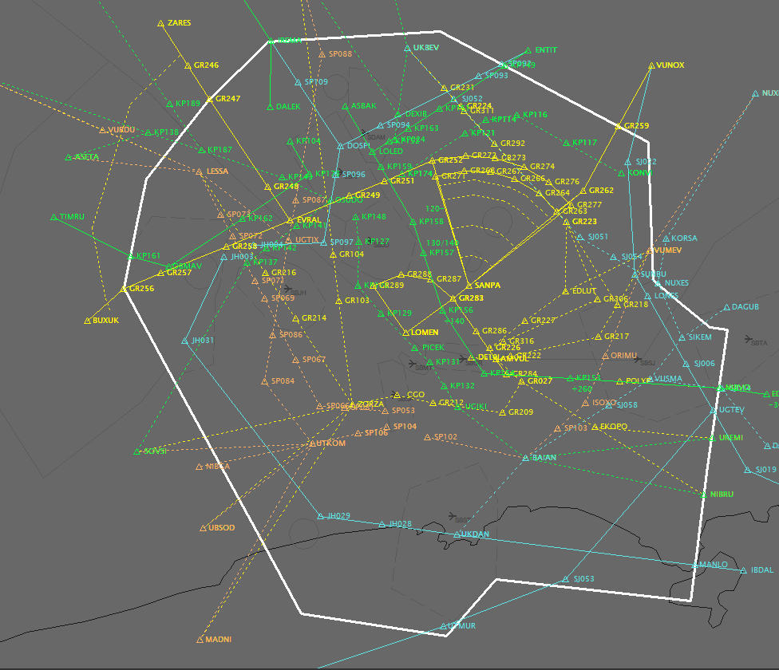

--8<-- "includes/abreviacoes.md"

# EuroScope

[EuroScope](https://www.euroscope.hu) is the controller's radar screen. It is where you see the sector, the traffic and the flight plans, and where you assume, clear and hand off every aircraft, in radar or procedural operation. It also brings together the METAR, the chat with pilots and controllers and the departure, inbound and exit lists.

{ loading=lazy }

It is the first program to connect and the last to disconnect: [TrackAudio](../trackaudio/index.en.md), [vATIS](../vatis/index.en.md) and [vacs](../vacs/index.en.md) depend on its connection.

## At Vatsim Brasil

Each FIR has a sector file package, published on AeroNav and installed with the [Sector File Manager](instalacao.en.md#install-the-sector-file-manager), with two profiles:

| Profile | Positions | Use |
| --- | --- | --- |
| `solo` | `DEL`, `RMP`, `GND` and `TWR` | Shows the aerodrome, the stands and the ground tags |
| `radar` | `APP` and `CTR` | Shows the control area, with airways, procedures and radar targets |

In both profiles, the **CCAMS** plugin assigns transponder codes and avoids duplicates between controllers.

## Guides

-   :material-download:{ .lg .middle } **Installation**

    ---

    Step-by-step path for installation, sector files and choosing a profile, with progress tracking.

    [:octicons-arrow-right-24: Installation](instalacao.en.md)

-   :material-monitor-eye:{ .lg .middle } **Usage**

    ---

    A typical session: connecting, reading the screen and the tags, working the lists and closing.

    [:octicons-arrow-right-24: Usage](utilizacao.en.md)

-   :material-keyboard-outline:{ .lg .middle } **Command Guide**

    ---

    Keyboard shortcuts and command-line commands, with a quiz to lock in the main ones.

    [:octicons-arrow-right-24: Command Guide](comandos.en.md)

!!! tip "Tip"
    The EuroScope user manual is on the [official website](https://www.euroscope.hu), under `Documentation` › `Download User's Guide`. It is worth reading once you are comfortable with the basics.
