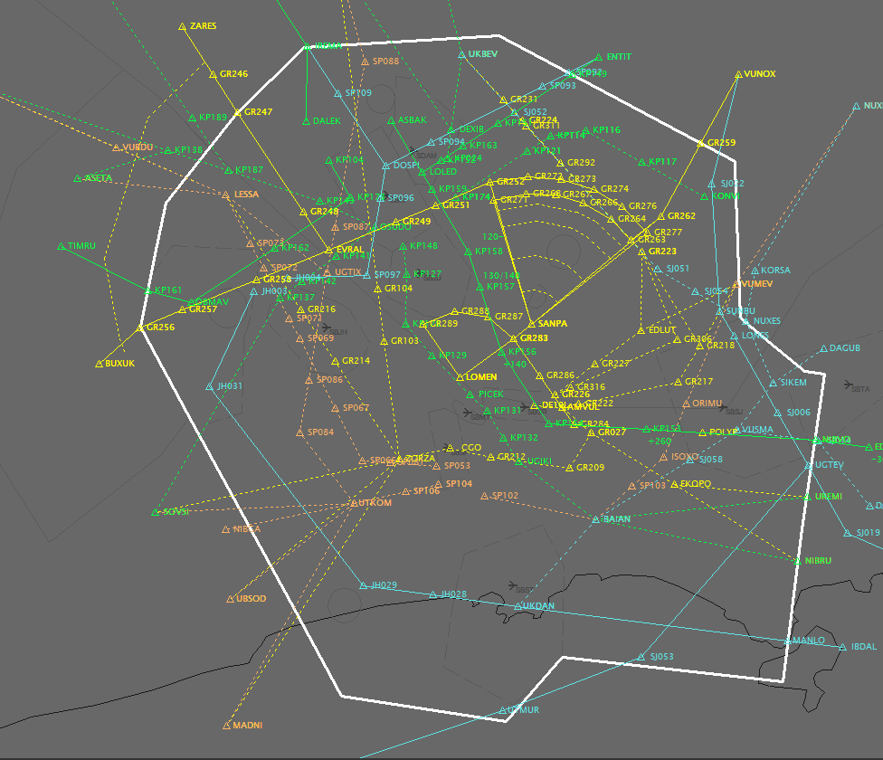

--8<-- "includes/abreviacoes.md"

# EuroScope

O [EuroScope](https://www.euroscope.hu) é a tela radar do controlador. É nele que você vê o setor, os tráfegos e os planos de voo, e é por ele que você assume, autoriza e transfere cada aeronave, em operação radar ou convencional. Também reúne o METAR, o chat com pilotos e controladores e as listas de partida, de entrada e de saída.

{ loading=lazy }

É o primeiro programa a conectar e o último a desconectar: o [TrackAudio](../trackaudio/index.pt.md), o [vATIS](../vatis/index.pt.md) e o [vacs](../vacs/index.pt.md) dependem da conexão dele.

## Na Vatsim Brasil

Cada FIR tem um pacote de arquivos de setor, publicado no AeroNav e instalado com o [Sector File Manager](instalacao.pt.md#instale-o-sector-file-manager), com dois perfis:

| Perfil | Posições | Uso |
| --- | --- | --- |
| `solo` | `DEL`, `RMP`, `GND` e `TWR` | Mostra o aeródromo, os estacionamentos e as etiquetas de solo |
| `radar` | `APP` e `CTR` | Mostra a área de controle, com aerovias, procedimentos e os alvos radar |

Nos dois perfis, o plugin **CCAMS** distribui os códigos transponder e evita repetições entre controladores.

## Guias

-   :material-download:{ .lg .middle } **Instalação**

    ---

    Trilha da instalação, dos arquivos de setor e da escolha do perfil, com marcação do progresso.

    [:octicons-arrow-right-24: Instalação](instalacao.pt.md)

-   :material-monitor-eye:{ .lg .middle } **Utilização**

    ---

    Uma sessão típica: conectar, ler a tela e as etiquetas, trabalhar com as listas e encerrar.

    [:octicons-arrow-right-24: Utilização](utilizacao.pt.md)

-   :material-keyboard-outline:{ .lg .middle } **Guia de Comandos**

    ---

    Os atalhos de teclado e os comandos de linha, com um quiz para fixar os principais.

    [:octicons-arrow-right-24: Guia de Comandos](comandos.pt.md)

!!! tip "Dica"
    O manual do usuário do EuroScope está no [site oficial](https://www.euroscope.hu), em `Documentation` › `Download User's Guide`. Vale a leitura depois que você estiver à vontade com o básico.
