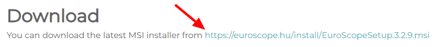

--8<-- "includes/abreviacoes.md"

# Installation

From download to your first open profile, in six steps. Mark each one when done: the portal saves your progress in this browser.

!!! info "Windows only"
    EuroScope is only available for *Microsoft Windows*.

### Download EuroScope

Go to the [EuroScope website](https://www.euroscope.hu) and open the downloads page under `Installation`, on the top bar.

{ : style="border:2px solid #999" loading=lazy }

In the *Download* section, click the installer link.

{ : style="border:2px solid #999" loading=lazy }

### Install the recommended version

Run the installer and follow the steps as usual.

!!! danger "Recommended version"
    Install version **3.2.3.2**, available [on this page](https://www.euroscope.hu/wp/2024/06/09/v3-2-2-3-and-v3-2-3-2-with-token-authentication-update/).

### Install the Sector File Manager

Vatsim Brasil sector files are published on [AeroNav](https://files.aero-nav.com/SBXX) and installed with the **[Sector File Manager](https://github.com/VectorsATCGroup/euroscope-sector-file-manager)**, a free program by Vectors ATC Group that downloads, installs and updates the packages in one click.

1. Download and install the **[Vectors ATC Hub](https://github.com/VectorsATCGroup/vectors-atc-releases/releases/latest/download/VectorsATCHub-Setup.exe)**, the installer for the Vectors ATC Group programs.
2. In the Hub, install the **Sector File Manager**. The Hub also keeps the program up to date.

!!! info "What you need"
    - Windows 10 or newer, 64-bit.
    - An AeroNav account. You sign in on AeroNav's own page, in a window of the program, which never sees your password.

    It installs per user and does not ask for administrator rights.

### Install the sector files

1. Open the Sector File Manager. On first run, it finds the EuroScope installation and the sector files folder on its own.
2. Click **Authenticate** and sign in to your account on the AeroNav page. The sign-in window closes by itself when the package list shows up.
3. The dashboard shows the five Vatsim Brasil FIRs: **SBAO**, **SBAZ**, **SBBS**, **SBCW** and **SBRE**. Click **Install** on the FIRs you will control.

Before each installation, the program takes an automatic backup. If something fails midway, it rolls the operation back.

!!! tip "Install every FIR"
    With all five installed, you are ready to control in any FIR, and a last-minute switch will not catch you without the sector.

### Open the right profile

Each FIR has two profiles (`.prf`):

| Profile | Positions |
| --- | --- |
| `solo` | `DEL`, `RMP`, `GND` and `TWR`, with colours and tags designed for ground work |
| `radar` | `APP` and `CTR` |

Open EuroScope, choose the profile of the FIR you will control and explore the screen without connecting.

!!! warning "The profile dialog did not show up?"
    EuroScope opened straight into the last profile used. Untick `Auto load last profile on startup` and open the program again.

!!! warning "Switching FIRs?"
    If the new position is in another FIR, close EuroScope and open the correct profile. Loading the new sector or ASR with the program open is not enough.

### Keep the files up to date

Sector files follow the AIRAC cycle. Before each session, with EuroScope closed, open the Sector File Manager: the dashboard shows, for each FIR, the installed and the available AIRAC. If **Update** shows up, click it.

| The update replaces | The update keeps |
| --- | --- |
| Sector (`.sct` and `.ese`), ASR, NavData, alias and the package's vATIS settings | The `solo` and `radar` profiles (`.prf`) and your customisations in the `Settings/SOLO` and `Settings/RADAR` folders |
| `login_profiles.txt`, `VoiceChannels.txt` and `AircraftPerformance.txt` | Plugins and files you created that are not part of the package |

!!! warning "Edited one of those three files?"
    Hand edits to `login_profiles.txt`, `VoiceChannels.txt` and `AircraftPerformance.txt` are lost on update. The automatic backup keeps the previous version.

If the AeroNav session expires, the program asks you to sign in again and carries on with the operation.

[:octicons-arrow-right-24: Usage](utilizacao.en.md){ .md-button .md-button--primary }

