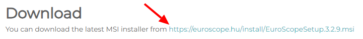

--8<-- "includes/abreviacoes.md"

# Instalação

Do download ao primeiro perfil aberto, em seis etapas. Marque cada uma ao terminar: o portal guarda o seu progresso neste navegador.

!!! info "Só para Windows"
    O EuroScope está disponível apenas para *Microsoft Windows*.

### Baixe o EuroScope

Acesse o [site do EuroScope](https://www.euroscope.hu) e abra a página de downloads em `Installation`, na barra superior.

{ : style="border:2px solid #999" loading=lazy }

Na seção *Download*, clique no link do instalador.

{ : style="border:2px solid #999" loading=lazy }

### Instale a versão recomendada

Execute o instalador e siga as etapas normalmente.

!!! danger "Versão recomendada"
    Instale a versão **3.2.3.2**, disponível [nesta página](https://www.euroscope.hu/wp/2024/06/09/v3-2-2-3-and-v3-2-3-2-with-token-authentication-update/).

### Instale o Sector File Manager

Os arquivos de setor da Vatsim Brasil são publicados no [AeroNav](https://files.aero-nav.com/SBXX) e instalados com o **[Sector File Manager](https://github.com/VectorsATCGroup/euroscope-sector-file-manager)**, um programa gratuito do Vectors ATC Group que baixa, instala e atualiza os pacotes com um clique.

1. Baixe e instale o **[Vectors ATC Hub](https://github.com/VectorsATCGroup/vectors-atc-releases/releases/latest/download/VectorsATCHub-Setup.exe)**, o instalador dos programas do Vectors ATC Group.
2. No Hub, instale o **Sector File Manager**. O Hub também mantém o programa atualizado.

!!! info "Do que você precisa"
    - Windows 10 ou mais novo, 64 bits.
    - Uma conta no AeroNav. O login é feito na própria página do AeroNav, numa janela do programa, que nunca vê a sua senha.

    A instalação é por usuário e não pede permissão de administrador.

### Instale os arquivos de setor

1. Abra o Sector File Manager. Na primeira vez, ele encontra sozinho a instalação do EuroScope e a pasta dos arquivos de setor.
2. Clique em **Authenticate** e entre na sua conta na página do AeroNav. A janela de login fecha sozinha quando a lista de pacotes aparece.
3. O painel mostra as cinco FIRs da Vatsim Brasil: **SBAO**, **SBAZ**, **SBBS**, **SBCW** e **SBRE**. Clique em **Install** nas FIRs em que você vai controlar.

Antes de cada instalação, o programa faz um backup automático. Se algo der errado no meio, ele desfaz a operação.

!!! tip "Instale todas as FIRs"
    Com as cinco instaladas, você já está pronto para controlar em qualquer FIR, e uma troca de última hora não pega você sem o setor.

### Abra o perfil certo

Cada FIR tem dois perfis (`.prf`):

| Perfil | Posições |
| --- | --- |
| `solo` | `DEL`, `RMP`, `GND` e `TWR`, com cores e etiquetas pensadas para o solo |
| `radar` | `APP` e `CTR` |

Abra o EuroScope, escolha o perfil da FIR em que vai controlar e explore a tela sem conectar.

!!! warning "A caixa de perfis não apareceu?"
    O EuroScope abriu direto no último perfil usado. Desmarque a opção `Auto load last profile on startup` e abra o programa de novo.

!!! warning "Trocou de FIR?"
    Se a nova posição fica em outra FIR, feche o EuroScope e abra o perfil correto. Carregar o novo setor ou ASR com o programa aberto não basta.

### Mantenha os arquivos atualizados

Os arquivos de setor acompanham o ciclo AIRAC. Antes de cada sessão, com o EuroScope fechado, abra o Sector File Manager: o painel mostra, para cada FIR, o AIRAC instalado e o disponível. Se aparecer **Update**, clique nele.

| A atualização substitui | A atualização preserva |
| --- | --- |
| Setor (`.sct` e `.ese`), ASR, NavData, alias e as configurações do vATIS do pacote | Os perfis `solo` e `radar` (`.prf`) e as suas personalizações das pastas `Settings/SOLO` e `Settings/RADAR` |
| `login_profiles.txt`, `VoiceChannels.txt` e `AircraftPerformance.txt` | Os plugins e os arquivos que você criou e que não fazem parte do pacote |

!!! warning "Editou um desses três arquivos?"
    As alterações feitas à mão em `login_profiles.txt`, `VoiceChannels.txt` e `AircraftPerformance.txt` se perdem na atualização. O backup automático guarda a versão anterior.

Se a sessão do AeroNav expirar, o programa pede um novo login e continua a operação.

[:octicons-arrow-right-24: Utilização](utilizacao.pt.md){ .md-button .md-button--primary }

