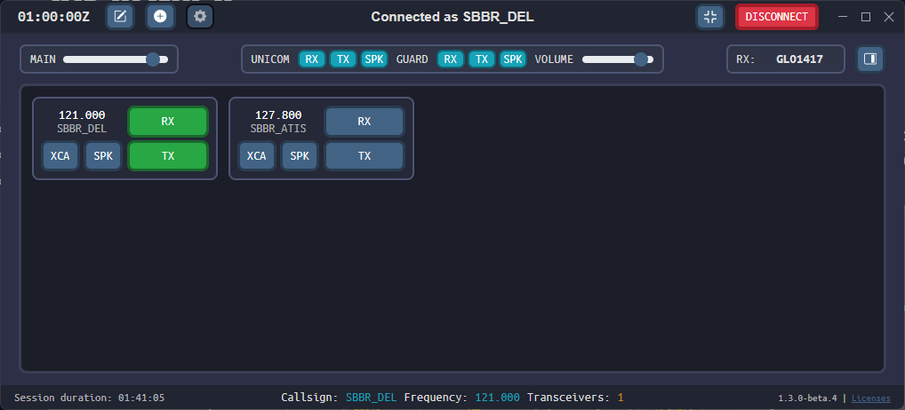

--8<-- "includes/abreviacoes.md"

# TrackAudio

[TrackAudio](https://github.com/pierr3/TrackAudio) is the controller's radio. It transmits and receives on your position's frequencies through the VATSIM voice network (*Audio for VATSIM*), with the push-to-talk (PTT) button. It runs on Windows, macOS and Linux.

{ : style="display:block; margin:auto; height:300px; border:2px solid #999" loading=lazy }

It replaces the old AFV client and VectorAudio, which is no longer maintained.

## How it fits into the workstation

- **It depends on EuroScope.** TrackAudio only connects to voice once your position is connected to the network.
- **It loads the position's frequencies.** Stations come from the AFV database, with transceivers placed by the division. That is why radio coverage follows the position's actual area.
- **It talks to other programs.** [vacs](../vacs/index.en.md) uses TrackAudio to share the PTT key between the radio and the coordination line.

## Guides

-   :material-download:{ .lg .middle } **Installation**

    ---

    Step-by-step installation and audio and PTT setup, with progress tracking.

    [:octicons-arrow-right-24: Installation](instalacao.en.md)

-   :material-radio-handheld:{ .lg .middle } **Usage**

    ---

    Connecting, enabling `RX` and `TX`, coupling transceivers, adding frequencies and closing.

    [:octicons-arrow-right-24: Usage](utilizacao.en.md)

## The buttons on each frequency

| Button | What it does |
| --- | --- |
| `RX` | Turns reception on. It turns **orange** when someone transmits on the frequency. |
| `TX` | Turns transmission on. It turns **orange** while you press the PTT. |
| `XCA` | Left-click: cross-couple across (XCA), joins different frequencies. Right-click: cross-couple (XC), couples the transceivers of the same frequency. |
| `SPK` | Plays the frequency audio on the speaker instead of the headset. |
