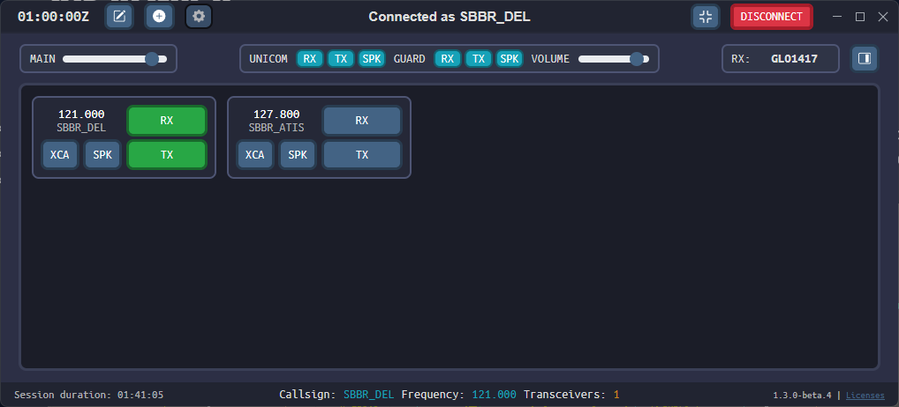

--8<-- "includes/abreviacoes.md"

# TrackAudio

O [TrackAudio](https://github.com/pierr3/TrackAudio) é o rádio do controlador. Ele transmite e recebe nas frequências da sua posição pela rede de voz da VATSIM (*Audio for VATSIM*), com o botão de *push-to-talk* (PTT). Roda em Windows, macOS e Linux.

{ : style="display:block; margin:auto; height:300px; border:2px solid #999" loading=lazy }

Ele substitui o antigo cliente AFV e o VectorAudio, que não é mais mantido.

## Como ele se encaixa na estação

- **Depende do EuroScope.** O TrackAudio só conecta à voz depois que a sua posição está conectada à rede.
- **Carrega as frequências da posição.** As estações vêm do banco de dados do AFV, com os transceptores posicionados pela divisão. Por isso a cobertura de rádio acompanha a área real da posição.
- **Conversa com outros programas.** O [vacs](../vacs/index.pt.md) usa o TrackAudio para dividir a tecla de PTT entre o rádio e a linha de coordenação.

## Guias

-   :material-download:{ .lg .middle } **Instalação**

    ---

    Trilha da instalação e da configuração do áudio e do PTT, com marcação do progresso.

    [:octicons-arrow-right-24: Instalação](instalacao.pt.md)

-   :material-radio-handheld:{ .lg .middle } **Utilização**

    ---

    Conectar, habilitar `RX` e `TX`, acoplar transceptores, adicionar frequências e encerrar.

    [:octicons-arrow-right-24: Utilização](utilizacao.pt.md)

## Os botões de cada frequência

| Botão | O que faz |
| --- | --- |
| `RX` | Liga a recepção. Fica **laranja** quando alguém transmite na frequência. |
| `TX` | Liga a transmissão. Fica **laranja** enquanto você aperta o PTT. |
| `XCA` | Clique esquerdo: *cross-couple across* (XCA), junta frequências diferentes. Clique direito: *cross-couple* (XC), acopla os transceptores da mesma frequência. |
| `SPK` | Toca o áudio da frequência no alto-falante em vez do fone. |
