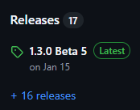
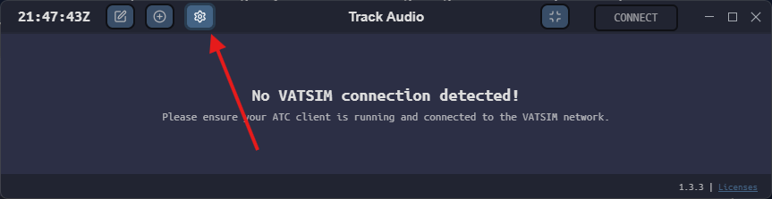
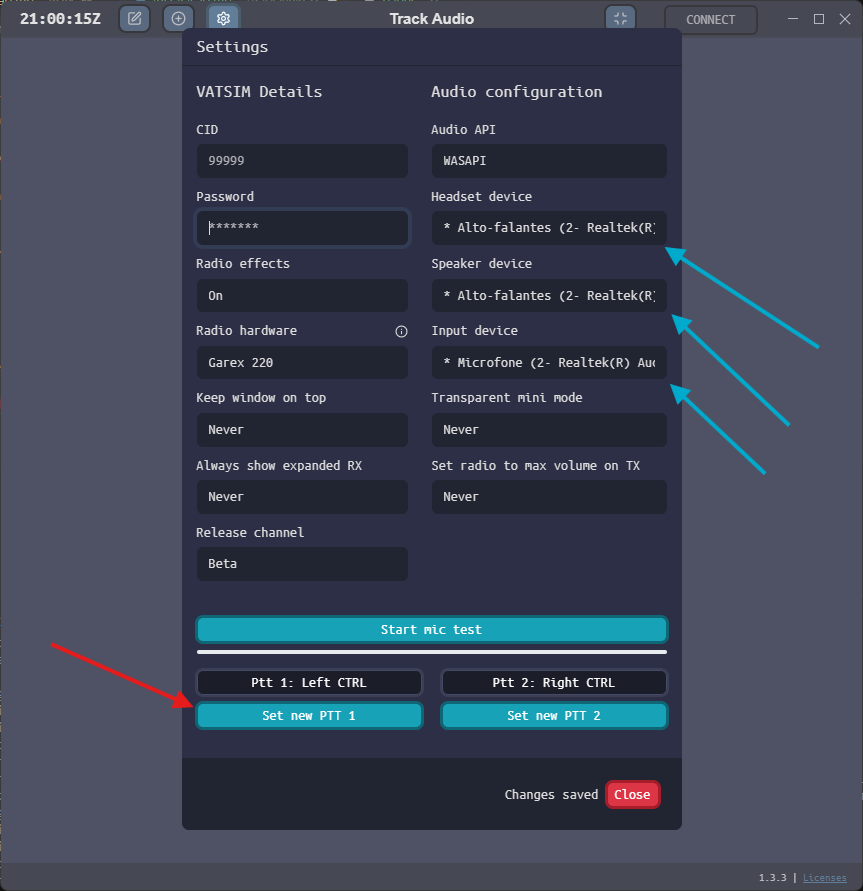

--8<-- "includes/abreviacoes.md"

# Installation

From installation to a working PTT, in four steps. Mark each one when done: the portal saves your progress in this browser.

<div class="vb-trilha" data-chave="trackaudio-instalacao" markdown>

<div class="vb-passo" markdown>

### Download the latest version

1. Go to the [TrackAudio repository on GitHub](https://github.com/pierr3/TrackAudio).
2. Open the latest release, on the right side of the page.

    { : style="display:block; margin:auto; border:2px solid #999" loading=lazy }

3. In the **Assets** section, at the bottom of the page, download the file for your system:

| System | File |
| --- | --- |
| Windows | The `.exe` installer |
| macOS | The `.dmg` for your architecture: Apple Silicon (*arm64*) or Intel (*x64*) |
| Linux | `.deb` (Debian and Ubuntu), `.rpm` (Fedora, RHEL and openSUSE) or AppImage |

</div>

<div class="vb-passo" markdown>

### Install

=== "Windows"

    First install the [Visual C++ Redistributable](https://aka.ms/vs/17/release/vc_redist.x64.exe): without it, TrackAudio does not start. Then run the installer.

    On Windows, the program updates itself.

=== "macOS"

    Open the `.dmg` and copy the app to the **Applications** folder. You can also install it with Homebrew:

    ```text
    brew tap flymia/homebrew-trackaudio
    brew install --cask trackaudio
    ```

    To use a keyboard key as PTT, macOS asks for the **Input Monitoring** permission.

=== "Linux"

    Install your system's package, for example:

    ```text
    sudo dnf install ./trackaudio-*.rpm
    ```

    On Arch, there is the `trackaudio-bin` package in the AUR.

</div>

<div class="vb-passo" markdown>

### Enter your details and choose the devices

Open the settings with the gear in the top-left corner.

{ : style="display:block; margin:auto; width:800px; border:2px solid #999" loading=lazy }

1. Enter your **CID** and **VATSIM password**.
2. Choose the audio devices (blue arrows in the figure below):
    - **primary** output: the headset;
    - **secondary** output: the speaker, used by the `SPK` button;
    - **input**: the microphone.

{ : style="display:block; margin:auto; height:500px; border:2px solid #999" loading=lazy }

!!! warning "Error starting audio devices"
    This message shows when the input or the output is not selected. Select both.

**Settings › Audio** also holds the microphone gain (0 to 200%) and the sidetone (hearing your own voice).

</div>

<div class="vb-passo" markdown>

### Set up the PTT

Click the PTT button (red arrow in the figure) and press the key, mouse button or joystick button you will use. TrackAudio accepts **two** PTTs.

!!! tip "Tip"
    Pick a PTT you can reach without letting go of the mouse. If you will use [vacs](../vacs/index.en.md) with radio integration, do **not** set in TrackAudio the same key vacs uses as radio PTT.

[:octicons-arrow-right-24: Usage](utilizacao.en.md){ .md-button .md-button--primary }

</div>

</div>

## Where the files are

Settings and logs are kept in this folder:

| System | Folder |
| --- | --- |
| Windows | `%LocalAppData%\trackaudio` |
| macOS | `~/Library/Application Support/trackaudio` |
| Linux | `~/.local/state/trackaudio` |
