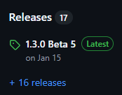
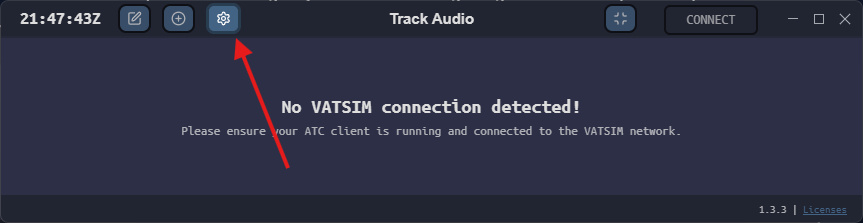
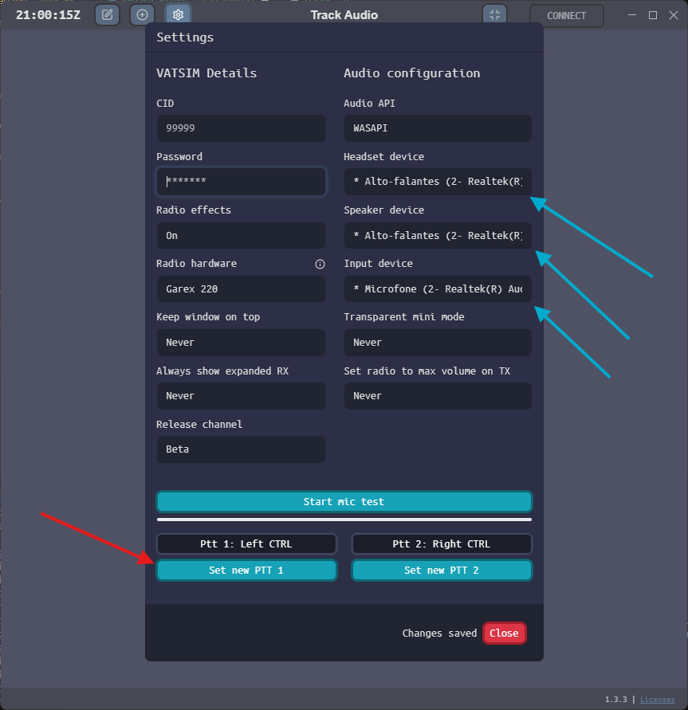

--8<-- "includes/abreviacoes.md"

# Instalação

Da instalação ao PTT configurado, em quatro etapas. Marque cada uma ao terminar: o portal guarda o seu progresso neste navegador.

<div class="vb-trilha" data-chave="trackaudio-instalacao" markdown>

<div class="vb-passo" markdown>

### Baixe a versão mais recente

1. Acesse o [repositório do TrackAudio no GitHub](https://github.com/pierr3/TrackAudio).
2. Abra o *release* mais recente, no lado direito da página.

    { : style="display:block; margin:auto; border:2px solid #999" loading=lazy }

3. Na seção **Assets**, no fim da página, baixe o arquivo do seu sistema:

| Sistema | Arquivo |
| --- | --- |
| Windows | O instalador `.exe` |
| macOS | O `.dmg` da sua arquitetura: Apple Silicon (*arm64*) ou Intel (*x64*) |
| Linux | `.deb` (Debian e Ubuntu), `.rpm` (Fedora, RHEL e openSUSE) ou AppImage |

</div>

<div class="vb-passo" markdown>

### Instale

=== "Windows"

    Instale antes o [Visual C++ Redistributable](https://aka.ms/vs/17/release/vc_redist.x64.exe): sem ele, o TrackAudio não abre. Depois, execute o instalador.

    No Windows, o programa se atualiza sozinho.

=== "macOS"

    Abra o `.dmg` e copie o aplicativo para a pasta **Aplicativos**. Também dá para instalar pelo Homebrew:

    ```text
    brew tap flymia/homebrew-trackaudio
    brew install --cask trackaudio
    ```

    Para usar uma tecla do teclado como PTT, o macOS pede a permissão de **Monitoramento de entrada**.

=== "Linux"

    Instale o pacote do seu sistema, por exemplo:

    ```text
    sudo dnf install ./trackaudio-*.rpm
    ```

    No Arch, há o pacote `trackaudio-bin` no AUR.

</div>

<div class="vb-passo" markdown>

### Informe seus dados e escolha os dispositivos

Abra as configurações pela engrenagem no canto superior esquerdo.

{ : style="display:block; margin:auto; width:800px; border:2px solid #999" loading=lazy }

1. Informe o seu **CID** e a sua **senha da VATSIM**.
2. Escolha os dispositivos de áudio (setas azuis na figura abaixo):
    - saída **primária**: o fone de ouvido;
    - saída **secundária**: o alto-falante, usado pelo botão `SPK`;
    - **entrada**: o microfone.

{ : style="display:block; margin:auto; height:500px; border:2px solid #999" loading=lazy }

!!! warning "Error starting audio devices"
    Essa mensagem aparece quando falta escolher a entrada ou a saída. Selecione as duas.

Em **Settings › Audio** também ficam o ganho do microfone (0 a 200%) e o retorno da própria voz (*sidetone*).

</div>

<div class="vb-passo" markdown>

### Configure o PTT

Clique no botão de PTT (seta vermelha na figura) e aperte a tecla, o botão do mouse ou o botão do *joystick* que vai usar. O TrackAudio aceita **dois** PTTs.

!!! tip "Dica"
    Escolha um PTT que você alcance sem tirar a mão do mouse. Se você vai usar o [vacs](../vacs/index.pt.md) com a integração de rádio, **não** configure no TrackAudio a mesma tecla que o vacs usa como PTT do rádio.

[:octicons-arrow-right-24: Utilização](utilizacao.pt.md){ .md-button .md-button--primary }

</div>

</div>

## Onde ficam os arquivos

As configurações e os registros (*logs*) ficam nesta pasta:

| Sistema | Pasta |
| --- | --- |
| Windows | `%LocalAppData%\trackaudio` |
| macOS | `~/Library/Application Support/trackaudio` |
| Linux | `~/.local/state/trackaudio` |
