--8<-- "includes/abreviacoes.md"

# Usage

This page walks through TrackAudio in a control session: connecting, enabling the frequency, transmitting, coupling transceivers and closing. It assumes the [installation](instalacao.en.md) is already done.

## Connecting

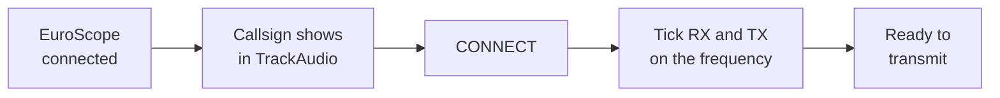

### 1. Connect EuroScope first

Without the position connected to the network, TrackAudio shows *"No VATSIM connection detected!"*.

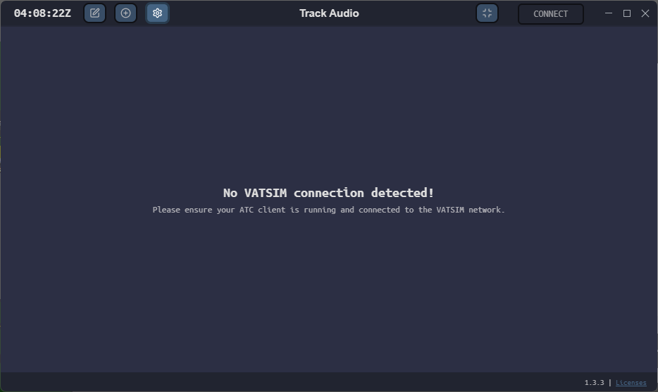{ : style="display:block; margin:auto; border:2px solid #999; height:300px;" loading=lazy }

Once [EuroScope](../euroscope/utilizacao.en.md#connecting-to-the-network) connects, the position callsign (in the example, `SBGO_TWR`) shows at the top and the `CONNECT` button turns green.

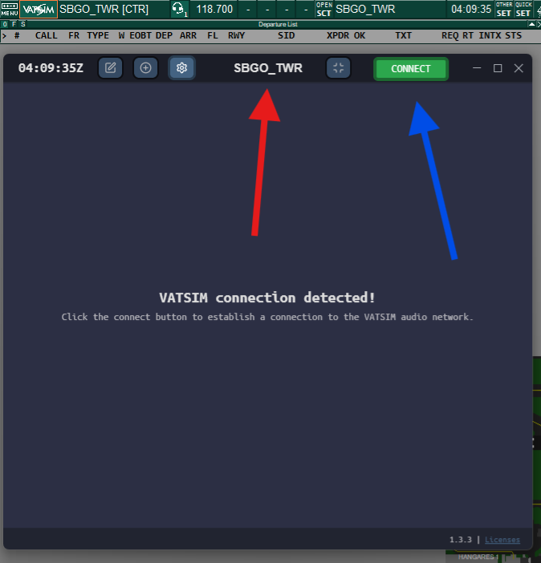{ : style="display:block; margin:auto; border:2px solid #999; height:300px;" loading=lazy }

### 2. Connect to the voice server

Click `CONNECT`. TrackAudio connects and shows your position's frequencies.

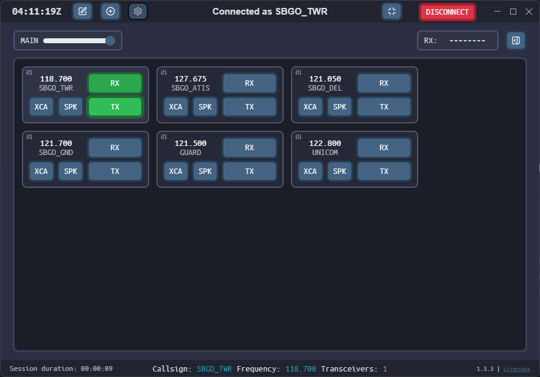{ : style="display:block; margin:auto; border:2px solid #999; height:300px;" loading=lazy }

### 3. Enable the frequency

!!! warning "Important"
    TrackAudio **does not enable** frequencies on its own. Tick `RX` and `TX` on the frequency you will use, in the example 118.700 MHz (`SBGO_TWR`).

| Button | Green | Orange |
| --- | --- | --- |
| `RX` | You are listening to the frequency | Someone is transmitting on it |
| `TX` | You are ready to transmit | You are transmitting, with the PTT pressed |

The `SPK` button plays the frequency on the speaker (the secondary output) instead of the headset.

## Transmitting

Press the PTT and talk. The frequency's `TX` turns orange while the PTT is pressed.

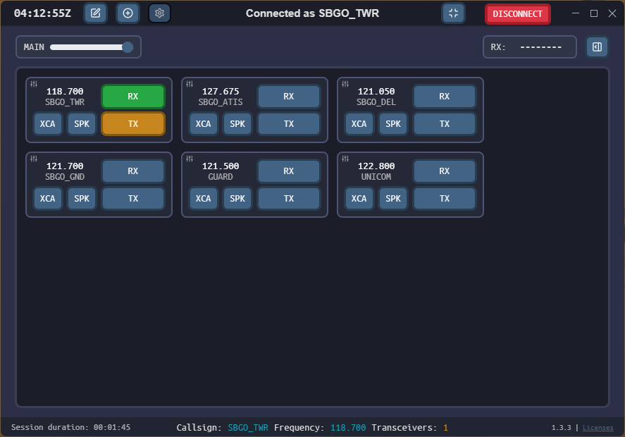{ : style="display:block; margin:auto; border:2px solid #999; height:300px;" loading=lazy }

Your callsign also shows in orange in the list of who is talking and goes back to white when the transmission ends.

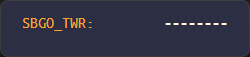{ : style="display:block; margin:auto; border:2px solid #999;" loading=lazy }

## Coupling transceivers: XC and XCA

A frequency can have several transceivers spread over the position's area. Each pilot transmits and receives through the nearest transceiver, so two pilots far apart may not hear each other. The `XCA` button solves this in two ways:

| Click | Function | What it does |
| --- | --- | --- |
| **Right** | `XC` (cross-couple) | Re-transmits what reaches one transceiver on all transceivers **of the same frequency**. Pilots in your area can hear each other. |
| **Left** | `XCA` (cross-couple across) | Joins **different frequencies**: pilots on one frequency hear those on the other, each within the range of their own transceivers. |

!!! tip "Tip"
    Use `XC` whenever your position has more than one transceiver, as on APP and CTR. Use `XCA` with care, only when you control more than one frequency and want all pilots to hear each other.

## Listening to and adding frequencies

### Several frequencies at once

You can listen to more than one frequency. In the example, the controller is listening to `SBGO_TWR` (118.700) and `SBGO_ATIS` (127.675), and the ATIS `RX` is orange because there is a transmission on it.

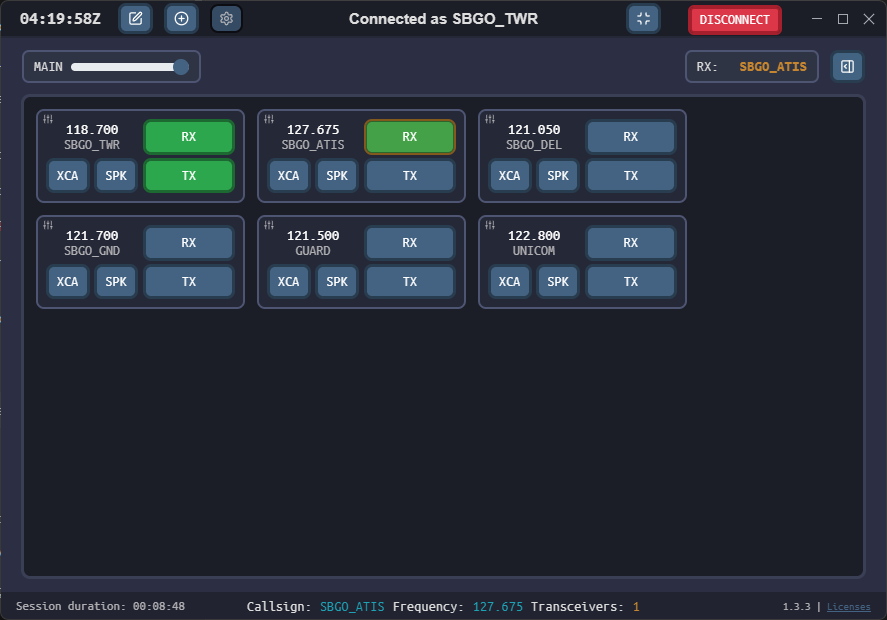{ : style="display:block; margin:auto; border:2px solid #999; height:300px;" loading=lazy }

This is useful to follow a neighbouring sector or check your ATIS.

### Adding a station or frequency

Click the **+**, in the top-left corner.

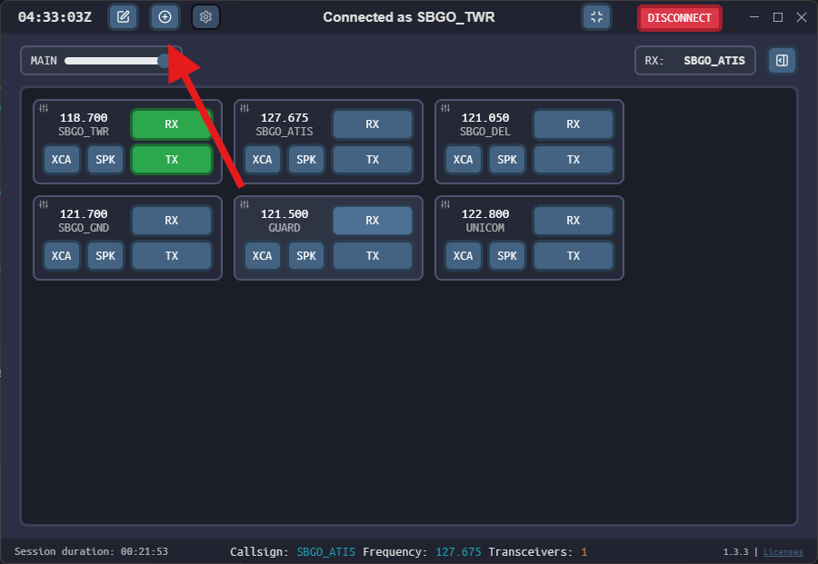{ : style="display:block; margin:auto; border:2px solid #999; height:300px;" loading=lazy }

In the window, type a station callsign (`SBGO_GND`, `SBXP_APP`, `SBRE_W_CTR`) or a frequency in the `XXX.XXX` format.

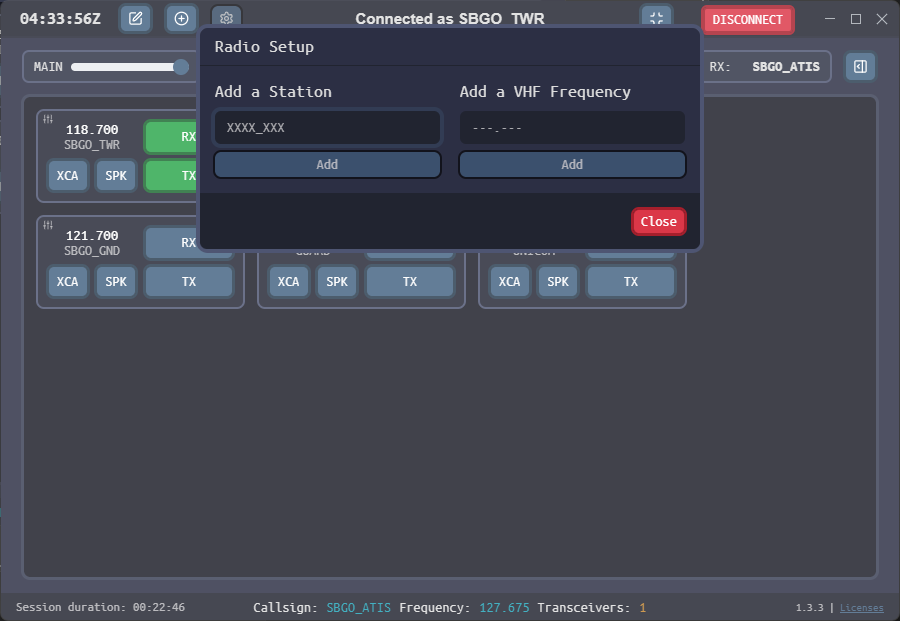{ : style="display:block; margin:auto; border:2px solid #999; height:300px;" loading=lazy }

!!! info "Station or frequency?"
    Prefer the **callsign**. The station comes from the AFV database, with all transceivers defined by the division. A typed frequency creates **a single** transceiver at your EuroScope visibility centre, with less coverage.

    If the station does not show up, it has not been set up yet. Let the Vatsim Brasil team know.

### Removing frequencies

Click the pencil in the top corner to enter **edit mode**. Select the frequencies to remove (they turn light blue) and click the red bin.

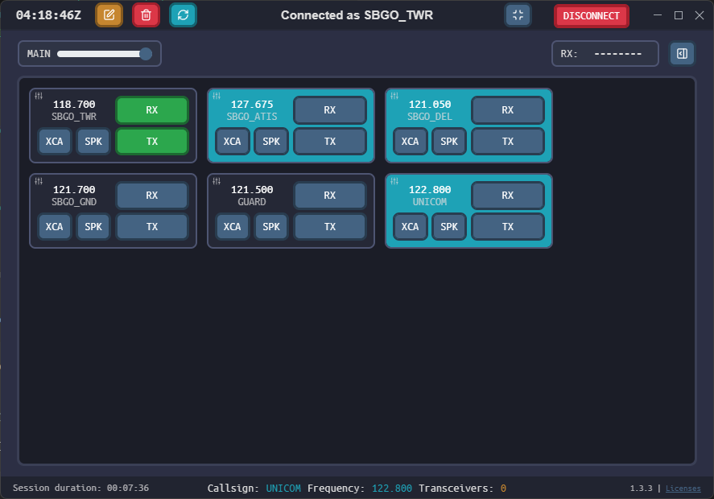{ : style="display:block; margin:auto; border:2px solid #999; height:300px;" loading=lazy }

### ADVISORY and Guard

TrackAudio has built-in support for the network advisory frequency, **ADVISORY** (122.800, called UNICOM in older versions), and the emergency frequency, **Guard** (121.500).

## Following the frequency

### Activity list (RX LIST)

Click the button next to the `RX:` field to open the **RX LIST**: the frequencies you listen to, with the callsign of the last aircraft that spoke on each. Orange marks who is talking now. Dashes (`--------`) mark frequencies with no recent activity.

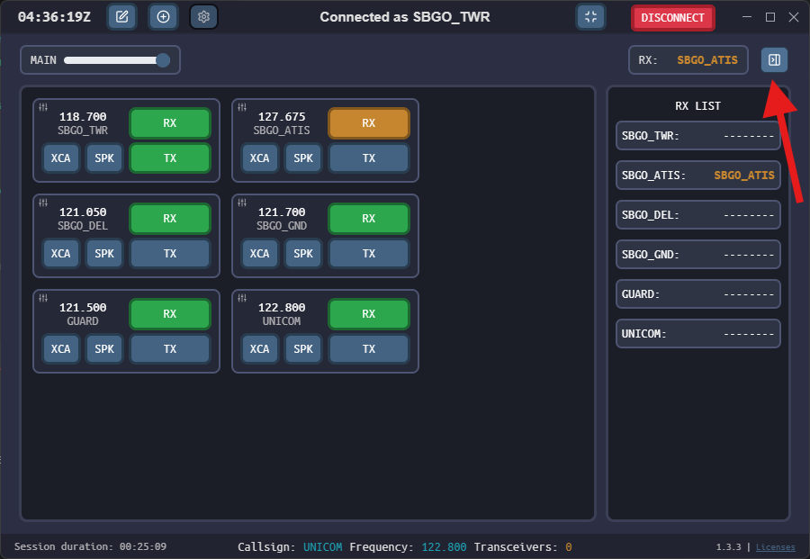{ : style="display:block; margin:auto; border:2px solid #999; height:300px;" loading=lazy }

### Footer

The footer shows the session duration, your callsign, the active frequency and the number of transceivers in use on it. If the transceiver count looks low, check that you added the station by callsign.

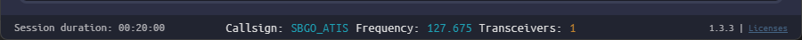{ : style="display:block; margin:auto; border:2px solid #999;" loading=lazy }

### Main volume

The **MAIN** slider adjusts the volume of all frequencies at once.

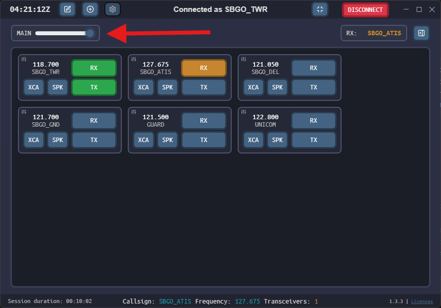{ : style="display:block; margin:auto; border:2px solid #999; height:300px;" loading=lazy }

## Mini mode

The button in the top-right corner shrinks TrackAudio to a small window that can sit over the EuroScope radar.

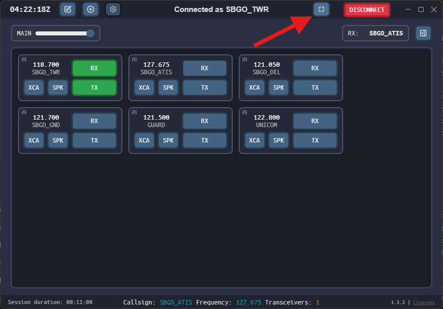{ : style="display:block; margin:auto; border:2px solid #999; height:300px;" loading=lazy }

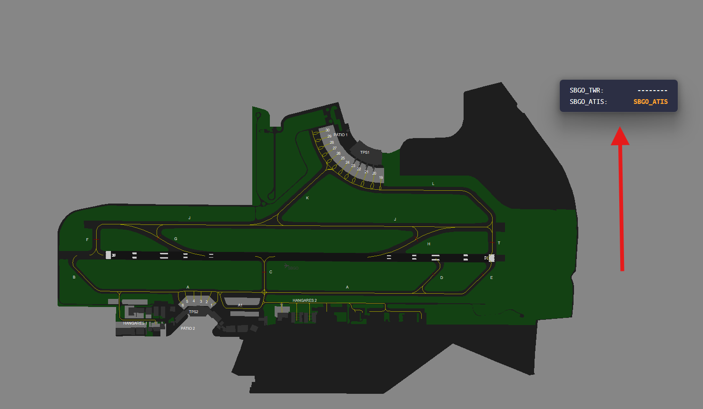{ : style="display:block; margin:auto; border:2px solid #999; height:300px;" loading=lazy }

Frequencies are on the left and, on the right, the callsign of whoever spoke last. Orange means a transmission in progress, and dashes mean nobody has spoken yet.

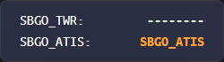{ : style="display:block; margin:auto; border:2px solid #999;" loading=lazy }

## Closing

Click `DISCONNECT`, in the top-right corner. If you disconnect EuroScope first, TrackAudio ends the voice session on its own.

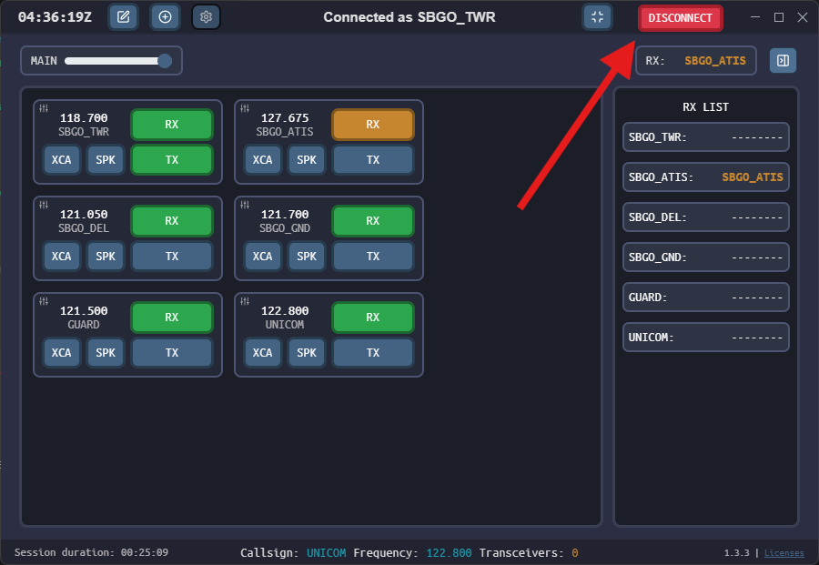{ : style="display:block; margin:auto; border:2px solid #999; height:300px;" loading=lazy }

!!! warning "Session ended on its own"
    If the callsign changes during the session, or if the network or internet connection drops, TrackAudio ends voice and shows a red warning such as *"Callsign changed during an active session, you have been disconnected."*. Reconnect and tick `RX` and `TX` again.

    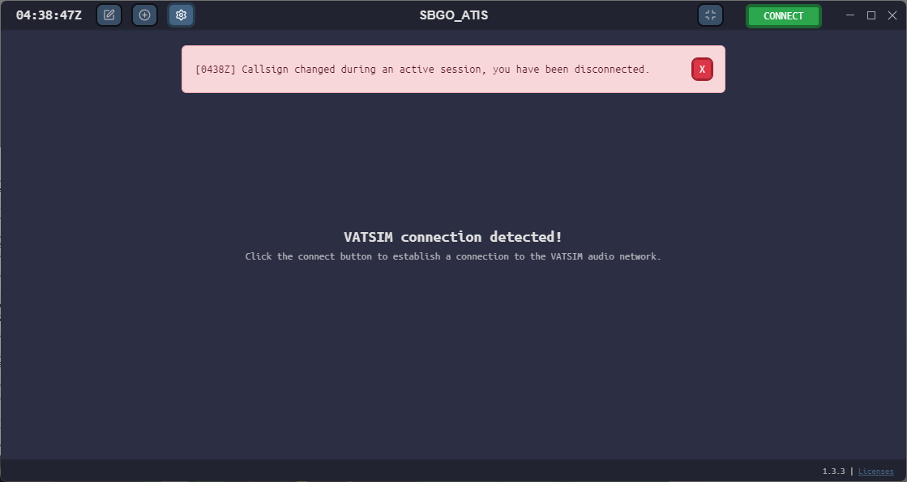{ : style="display:block; margin:auto; border:2px solid #999; height: 300px;" loading=lazy }

## Integrations

TrackAudio opens a local interface (TCP port **49080**) used by other programs. Through it, [vacs](../vacs/index.en.md) switches radio transmission on and off, and plugins such as the Stream Deck one show the state of the frequencies. For that, TrackAudio must be open and connected to voice.
