--8<-- "includes/abreviacoes.md"

# Utilização

Esta página mostra o TrackAudio numa sessão de controle: conectar, habilitar a frequência, transmitir, acoplar transceptores e encerrar. Ela parte do ponto em que a [instalação](instalacao.pt.md) já foi feita.

## Conectando

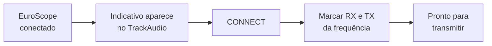

### 1. Conecte o EuroScope primeiro

Sem a posição conectada à rede, o TrackAudio mostra *"No VATSIM connection detected!"*.

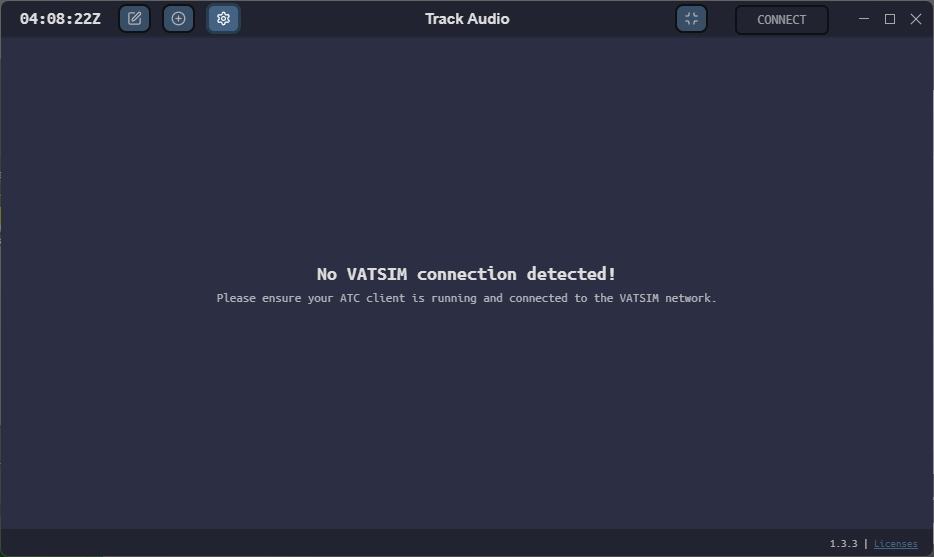{ : style="display:block; margin:auto; border:2px solid #999; height:300px;" loading=lazy }

Depois que o [EuroScope](../euroscope/utilizacao.pt.md#conectando-a-rede) conecta, o indicativo da posição (no exemplo, `SBGO_TWR`) aparece no topo e o botão `CONNECT` fica verde.

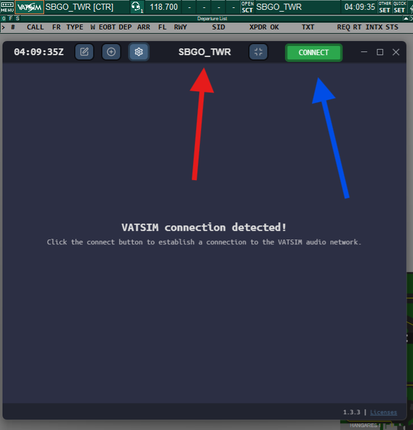{ : style="display:block; margin:auto; border:2px solid #999; height:300px;" loading=lazy }

### 2. Conecte ao servidor de voz

Clique em `CONNECT`. O TrackAudio conecta e mostra as frequências da sua posição.

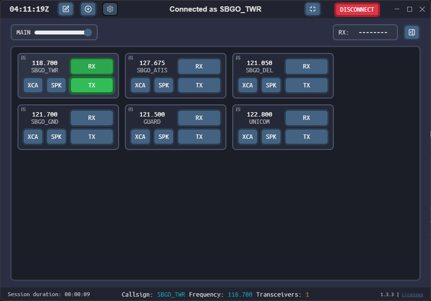{ : style="display:block; margin:auto; border:2px solid #999; height:300px;" loading=lazy }

### 3. Habilite a frequência

!!! warning "Importante"
    O TrackAudio **não habilita** as frequências sozinho. Marque `RX` e `TX` da frequência que vai usar, no exemplo 118.700 MHz (`SBGO_TWR`).

| Botão | Verde | Laranja |
| --- | --- | --- |
| `RX` | Você está ouvindo a frequência | Alguém está transmitindo nela |
| `TX` | Você está pronto para transmitir | Você está transmitindo, com o PTT apertado |

O botão `SPK` toca a frequência no alto-falante (a saída secundária) em vez do fone.

## Transmitindo

Aperte o PTT e fale. O `TX` da frequência fica laranja enquanto o PTT estiver apertado.

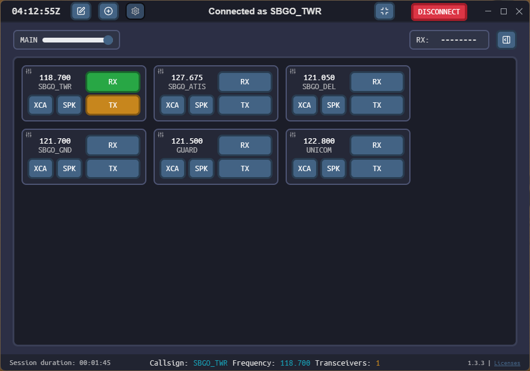{ : style="display:block; margin:auto; border:2px solid #999; height:300px;" loading=lazy }

O seu indicativo também aparece em laranja na lista de quem está falando e volta a branco ao fim da transmissão.

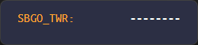{ : style="display:block; margin:auto; border:2px solid #999;" loading=lazy }

## Acoplando transceptores: XC e XCA

Uma frequência pode ter vários transceptores espalhados pela área da posição. Cada piloto transmite e recebe pelo transceptor mais próximo, e por isso dois pilotos distantes podem não se ouvir. O botão `XCA` resolve isso de duas formas:

| Clique | Função | O que faz |
| --- | --- | --- |
| **Direito** | `XC` (*cross-couple*) | Retransmite o que chega a um transceptor em todos os transceptores **da mesma frequência**. Os pilotos da sua área passam a se ouvir. |
| **Esquerdo** | `XCA` (*cross-couple across*) | Junta **frequências diferentes**: pilotos em uma frequência ouvem os da outra, cada um no alcance dos próprios transceptores. |

!!! tip "Dica"
    Use o `XC` sempre que a sua posição tiver mais de um transceptor, como nos APP e CTR. Use o `XCA` com cautela, só quando você controla mais de uma frequência e quer que todos os pilotos se ouçam.

## Ouvindo e adicionando frequências

### Várias frequências ao mesmo tempo

Você pode ouvir mais de uma frequência. No exemplo, o controlador ouve `SBGO_TWR` (118.700) e `SBGO_ATIS` (127.675), e o `RX` do ATIS está laranja porque há transmissão nele.

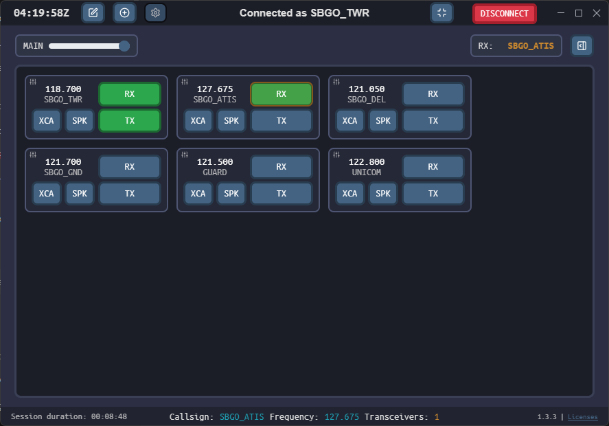{ : style="display:block; margin:auto; border:2px solid #999; height:300px;" loading=lazy }

Isso é útil para acompanhar um setor vizinho ou conferir o seu ATIS.

### Adicionando uma estação ou frequência

Clique no **+**, no canto superior esquerdo.

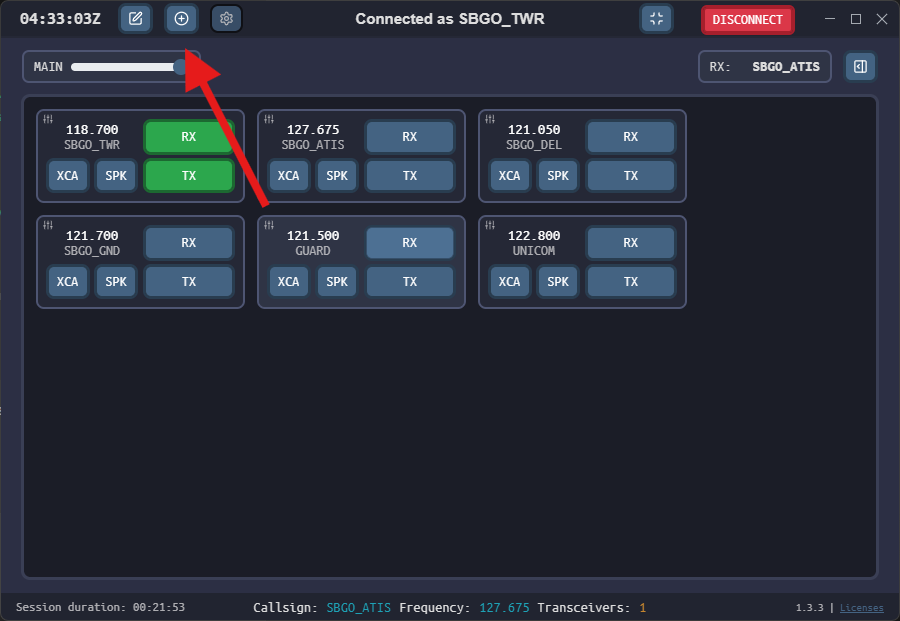{ : style="display:block; margin:auto; border:2px solid #999; height:300px;" loading=lazy }

Na janela, digite o indicativo de uma estação (`SBGO_GND`, `SBXP_APP`, `SBRE_W_CTR`) ou uma frequência no formato `XXX.XXX`.

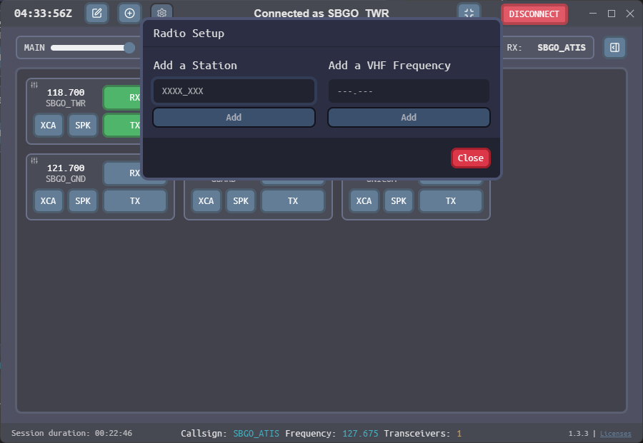{ : style="display:block; margin:auto; border:2px solid #999; height:300px;" loading=lazy }

!!! info "Estação ou frequência?"
    Prefira o **indicativo**. A estação vem do banco de dados do AFV, com todos os transceptores definidos pela divisão. Uma frequência digitada cria **um único** transceptor no centro de visibilidade do seu EuroScope, com cobertura menor.

    Se a estação não aparecer, ela ainda não foi cadastrada. Avise a equipe da Vatsim Brasil.

### Removendo frequências

Clique no lápis, no canto superior, para entrar no **modo de edição**. Selecione as frequências que quer remover (ficam em azul-claro) e clique na lixeira vermelha.

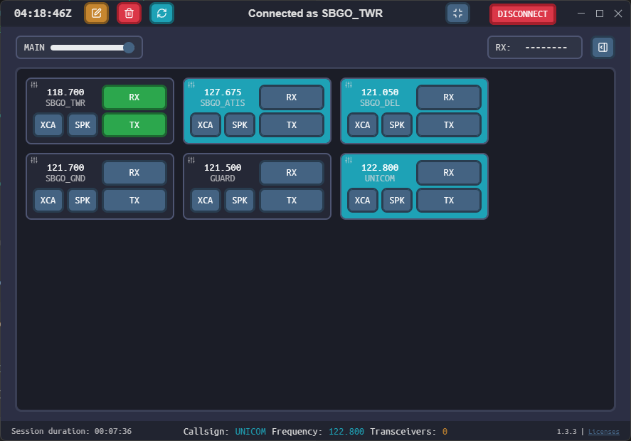{ : style="display:block; margin:auto; border:2px solid #999; height:300px;" loading=lazy }

### ADVISORY e Guarda

O TrackAudio tem suporte próprio à frequência de aviso da rede, **ADVISORY** (122.800, chamada de UNICOM nas versões antigas), e à frequência de emergência, **Guarda** (121.500).

## Acompanhando a frequência

### Lista de atividade (RX LIST)

Clique no botão ao lado do campo `RX:` para abrir a **RX LIST**: as frequências que você ouve, com o indicativo do último tráfego que falou em cada uma. Em laranja, quem está falando agora. Com traços (`--------`), as frequências sem atividade recente.

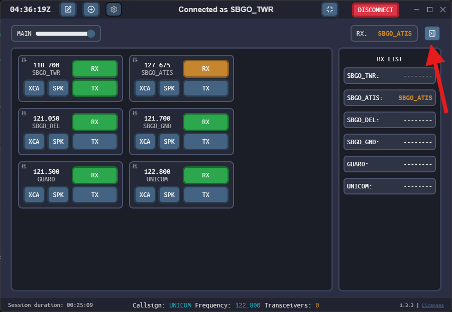{ : style="display:block; margin:auto; border:2px solid #999; height:300px;" loading=lazy }

### Rodapé

O rodapé mostra a duração da sessão, o seu indicativo, a frequência ativa e o número de transceptores em uso nela. Se o número de transceptores parecer baixo, confira se você adicionou a estação pelo indicativo.

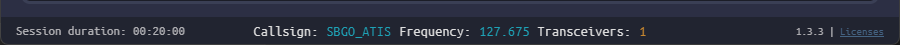{ : style="display:block; margin:auto; border:2px solid #999;" loading=lazy }

### Volume geral

O controle deslizante **MAIN** ajusta o volume de todas as frequências de uma vez.

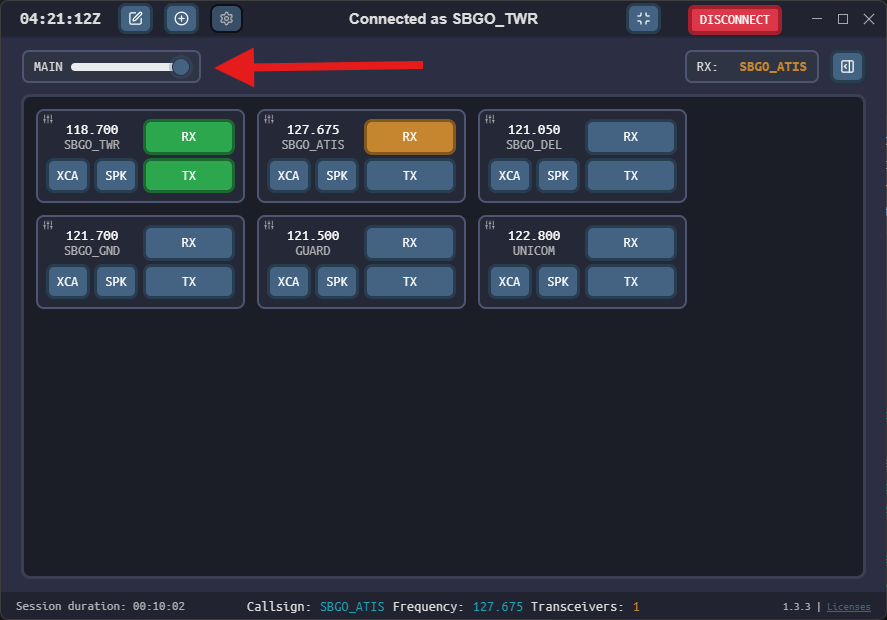{ : style="display:block; margin:auto; border:2px solid #999; height:300px;" loading=lazy }

## Modo minimizado

O botão no canto superior direito reduz o TrackAudio a uma janela pequena, que pode ficar sobre o radar do EuroScope.

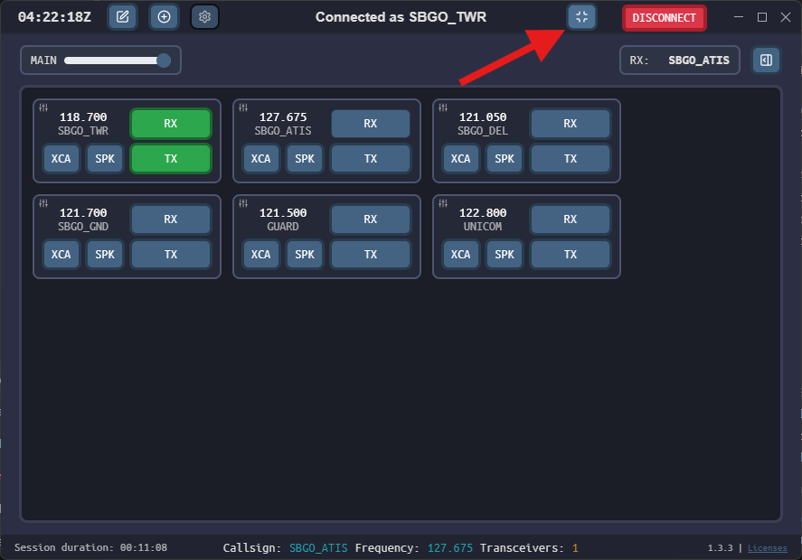{ : style="display:block; margin:auto; border:2px solid #999; height:300px;" loading=lazy }

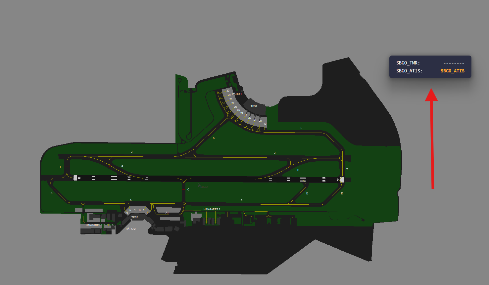{ : style="display:block; margin:auto; border:2px solid #999; height:300px;" loading=lazy }

À esquerda ficam as frequências e, à direita, o indicativo de quem falou por último. Laranja indica transmissão em curso, e traços indicam que ninguém falou ainda.

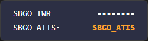{ : style="display:block; margin:auto; border:2px solid #999;" loading=lazy }

## Encerrando

Clique em `DISCONNECT`, no canto superior direito. Se você desconectar o EuroScope antes, o TrackAudio encerra a sessão de voz sozinho.

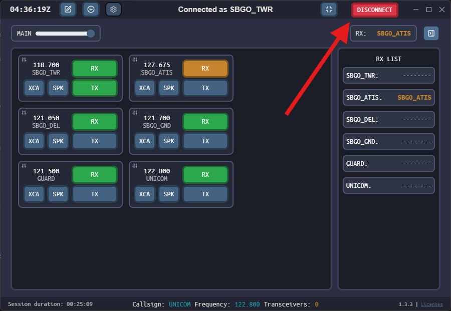{ : style="display:block; margin:auto; border:2px solid #999; height:300px;" loading=lazy }

!!! warning "Sessão encerrada sozinha"
    Se o indicativo mudar durante a sessão, ou se a conexão com a rede ou com a internet cair, o TrackAudio encerra a voz e mostra um aviso em vermelho, como *"Callsign changed during an active session, you have been disconnected."*. Reconecte e marque `RX` e `TX` de novo.

    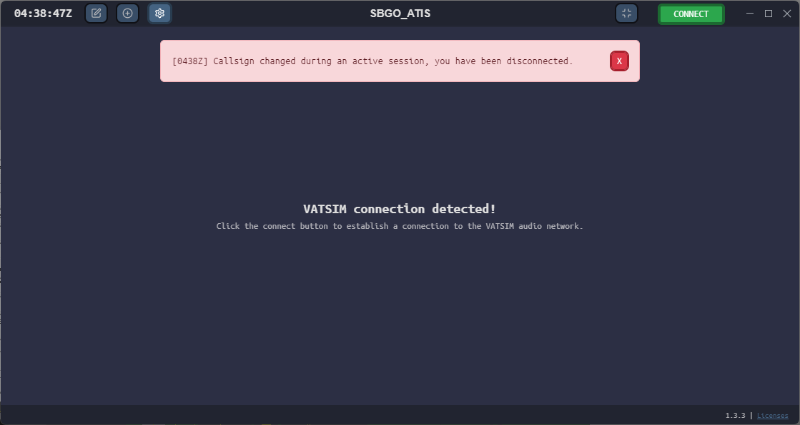{ : style="display:block; margin:auto; border:2px solid #999; height: 300px;" loading=lazy }

## Integrações

O TrackAudio abre uma interface local (porta TCP **49080**) usada por outros programas. É por ela que o [vacs](../vacs/index.pt.md) liga e desliga a transmissão do rádio, e que plugins como o do *Stream Deck* mostram o estado das frequências. Para isso, o TrackAudio precisa estar aberto e conectado à voz.
