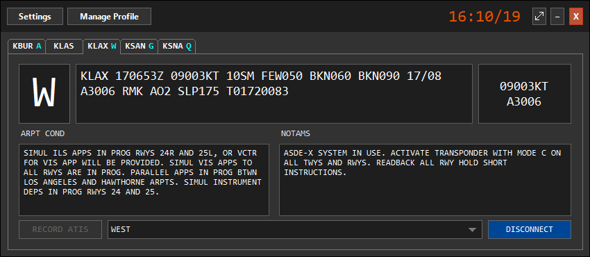

--8<-- "includes/abreviacoes.md"

# vATIS

[vATIS](https://vatis.app) builds and broadcasts the ATIS for the aerodromes where the controller is connected. It reads the METAR, adds the runway in use, the aerodrome conditions and the NOTAMs, and publishes it all as text and synthesized voice, on a connection of its own (`SBCT_ATIS`, for example). It runs on Windows, macOS and Linux.

{ loading=lazy }

## At Vatsim Brasil

Vatsim Brasil keeps **one profile per FIR**, with the stations, frequencies, runway presets, transition level calculation and contractions already set up. The profiles **update themselves**: you import once and do not need to edit anything.

## The ATIS in a session

## Guides

-   :material-download:{ .lg .middle } **Installation**

    ---

    Install the program, import your FIR's profile and fill in your details.

    [:octicons-arrow-right-24: Installation](instalacao.en.md)

-   :material-broadcast:{ .lg .middle } **Usage**

    ---

    Prepare, publish and maintain the ATIS, with a checklist to use during the session.

    [:octicons-arrow-right-24: Usage](utilizacao.en.md)

