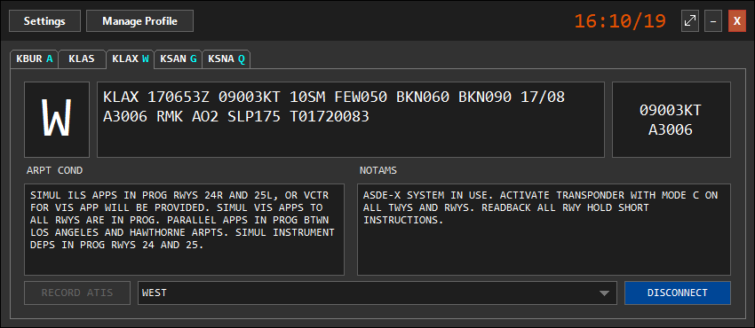
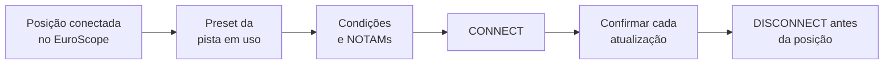

--8<-- "includes/abreviacoes.md"

# vATIS

O [vATIS](https://vatis.app) monta e transmite a informação ATIS dos aeródromos em que o controlador está conectado. Ele lê o METAR, junta a pista em uso, as condições do aeródromo e os NOTAMs e publica tudo em texto e em voz sintetizada, numa conexão própria (`SBCT_ATIS`, por exemplo). Roda em Windows, macOS e Linux.

{ loading=lazy }

## Na Vatsim Brasil

A Vatsim Brasil mantém **um perfil por FIR**, com as estações, as frequências, os *presets* de pista, o cálculo do nível de transição e as contrações já configurados. Os perfis **se atualizam sozinhos**: você importa uma vez e não precisa editar nada.

## O ATIS em uma sessão

## Guias

-   :material-download:{ .lg .middle } **Instalação**

    ---

    Instalar o programa, importar o perfil da sua FIR e preencher os seus dados.

    [:octicons-arrow-right-24: Instalação](instalacao.pt.md)

-   :material-broadcast:{ .lg .middle } **Utilização**

    ---

    Preparar, publicar e manter o ATIS, com um checklist para usar durante a sessão.

    [:octicons-arrow-right-24: Utilização](utilizacao.pt.md)

